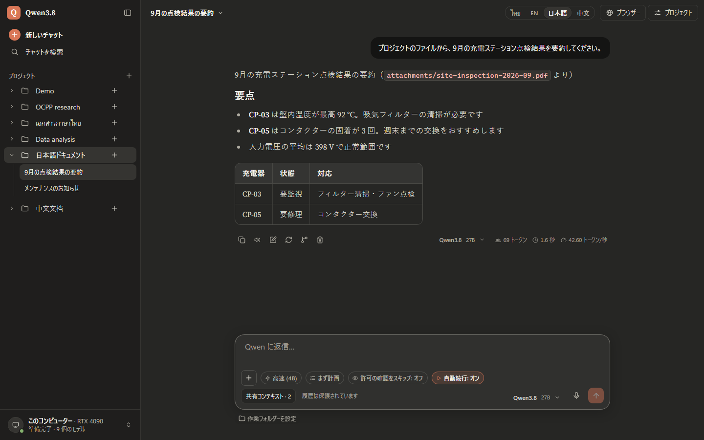
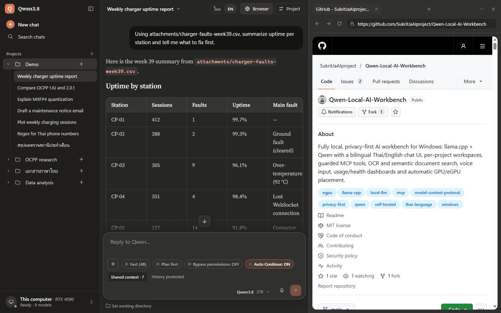
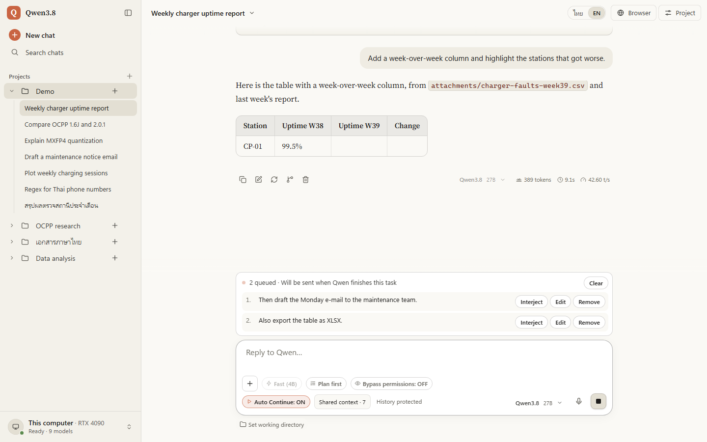
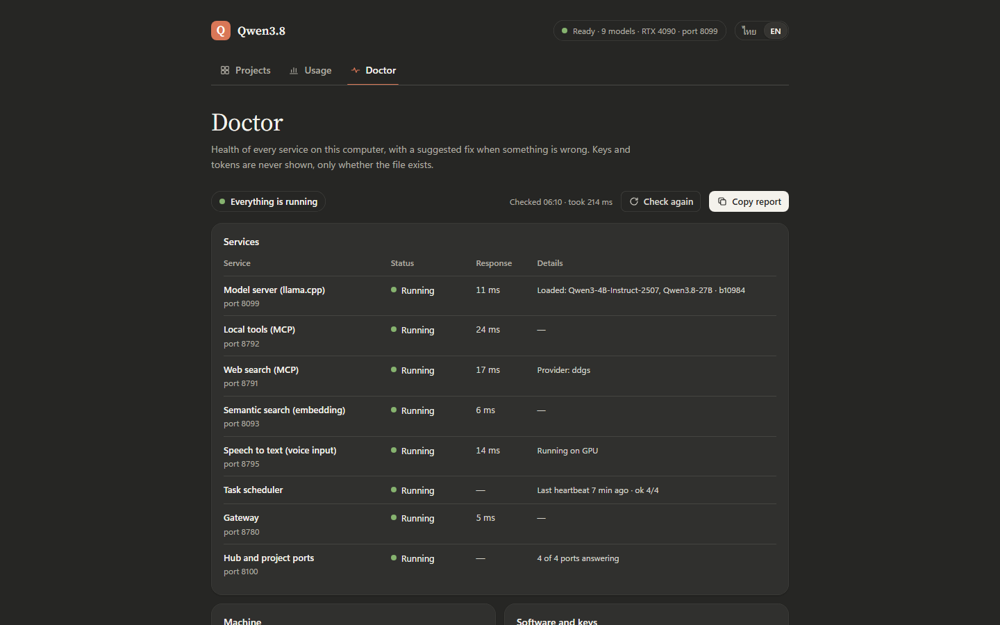
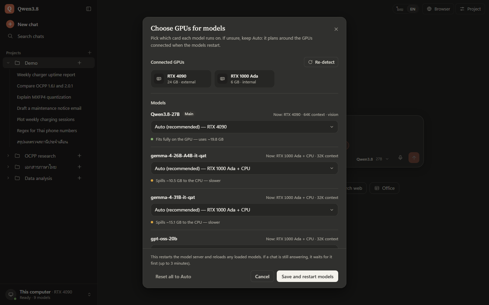

<div align="center">

# Qwen Local AI Workbench

**自分の Windows PC だけで動く、プライベートな AI ワークベンチ**<br>
チャット、プロジェクト、承認付きのツール、文書、音声、GPU の自動配置。llama.cpp と Qwen をベースに、<br>
画面は日本語・英語・タイ語・簡体字中国語に対応しています。

[](https://github.com/SukritJaAIproject/Qwen-Local-AI-Workbench/actions/workflows/tests.yml)
[](https://github.com/SukritJaAIproject/Qwen-Local-AI-Workbench/releases/latest)
[](LICENSE)
[](#必要なもの)
[](#必要なもの)

[English](README.md) · [ภาษาไทย](README.th.md) · **日本語** · [简体中文](README.zh-CN.md)

</div>



> [!NOTE]
> この文書は英語版 [README](README.md) の要約です。アーキテクチャ、設定、セキュリティ、テストの詳細は英語版をご覧ください。
> 日本語と簡体字中国語への対応は v1.1.0 より後に `main` ブランチに入りました。下の[クイックスタート](#クイックスタート)のとおり
> `git clone` すれば使えます。

## 概要

Qwen Local AI Workbench は、llama.cpp のサーバーと内蔵 WebUI を、チャット中心のすっきりした画面で包んだワークベンチです。
プロジェクトごとのワークスペース、承認付きのローカルツール（MCP）、内蔵ブラウザー、文書の読み取りと作成、ファイル検索、
音声入力、使用量とヘルスチェックのダッシュボード、内蔵 GPU と Thunderbolt 接続の eGPU への自動配置を備えています。

モデル、チャット、ファイル、埋め込み、OCR、音声認識はすべて `127.0.0.1` 上で動きます。データが PC の外に出るのは、
ウェブ系のツール（ウェブ検索、ページ取得、隔離ブラウザー、内蔵ブラウザーパネル、ディープリサーチ）を使うときだけです。
ウェブ検索のツールはどのプロジェクトでも最初から有効で、ツールの呼び出しはすべてチャットに表示されます。

| | |
|---|---|
| **動作環境** | Windows 11 + NVIDIA GPU。4B モデルは 6 GB で快適、27B は VRAM 約 20 GB が目安（RTX 4090 の eGPU で 42.8 tok/s） |
| **モデル** | Qwen3.8-27B（画像入力対応）、Qwen3-4B、Qwen3-Coder-30B-A3B、gpt-oss-20b 向けに設定済み。`C:\LLM\models` に置いたほかの GGUF もモデル選択に表示されます |
| **言語** | 画面、ツールのメッセージ、Doctor、リサーチレポート、音声入力、OCR が ไทย · English · 日本語 · 中文 に対応 |
| **プライバシー** | すべてのサービスは `127.0.0.1` だけで待ち受け、トークンと Origin/Host チェックで保護。コマンド、コード、ファイルの編集はあなたの許可を待ちます |
| **インストール** | `C:\LLM` に clone し、llama.cpp とモデルを置いて `Qwen38.cmd` をダブルクリック（[クイックスタート](#クイックスタート)） |

> [!IMPORTANT]
> 1 台の Windows 11 ノート PC で機能を積み上げてきた個人のセットアップです。毎日使っていて大規模なテストもありますが、
> パッケージ化された製品ではありません。パスは `C:\LLM` が前提で、いくつかの補助環境も決まった場所にあるものとしています。
> コードのコメントの多くはタイ語です。

## 主な機能

- **ローカルで完結:** すべてのサービスが `127.0.0.1` で動き、ルーター、埋め込み、MCP、音声認識はトークンで保護されています。
- **4 言語に全面対応:** 画面、llama.cpp WebUI のメニュー、Doctor、ツールの説明と結果、確認画面、ディープリサーチのレポート、
  音声入力、OCR が日本語・英語・タイ語・簡体字中国語に対応。チャットの本文が翻訳されることはありません。
- **プロジェクト:** プロジェクトごとにポート、チャット履歴、指示（システムプロンプト）、ファイル、メモリー、既定のモデル、
  思考モードが分かれ、ツールが触れる範囲も分離されます。
- **安心して使えるツール:** ファイル、シェル、Python、Office、メディア、隔離ブラウザーのツールはポリシーガードを通り、
  PC を変更する操作は、実行される内容をそのまま見せる 2 段階の確認が必要です。
- **文書とナレッジ:** PDF / DOCX / XLSX / PPTX / CSV の読み取り、スキャン文書の OCR、DOCX / XLSX / PPTX / PDF / CSV /
  Markdown の作成、キーワードと意味の両方によるファイル検索。
- **ディープリサーチ:** バックグラウンドで調査し、出典付きのレポートを Markdown と DOCX で出力します。
- **内蔵ブラウザー:** チャットの横にプロジェクト専用のブラウザーパネル。あなたとモデルが同じタブを操作し、
  接続できるのは公開アドレスだけです。
- **長いエージェント作業:** 作業中に次のメッセージを予約でき、Auto Continue がターン上限で自動的に続行し、
  途切れた返信も完了済みのツールを繰り返さずにつなぎ直します。
- **音声:** GPU 上の faster-whisper による音声入力（VRAM が足りないときは CPU で動作）と読み上げ。
- **長いチャットも続けられる:** コンテキストの上限が近づくと、会話の途中を自動で要約します。
- **ダッシュボード:** 使用量（トークン、モデル別の速度、プロジェクト別）と Doctor（サービスの状態、GPU、ディスク、対処法）。
- **GPU の自動配置:** 内蔵 GPU と Thunderbolt の eGPU を検出してモデルごとの配置を決め、画面から変更もできます。
  RTX 4090 をつなぐと、27B モデルが約 1〜2 tok/s から **42.8 tok/s** になりました。

## 日本語で使う

- **切り替え:** ไทย | EN | 日本語 | 中文 のボタン、または `Alt+Shift+L`。設定は `projects\settings.json` の `"lang"`
  （日本語は `"ja"`）に保存されます。
- **ツール:** ツールの一覧と説明、結果、エラー、実行前の確認画面が日本語になります。切り替えから 2 秒以内に反映され、
  再起動は不要です。
- **回答とレポート:** モデルは書かれた言語で答えるよう指示されています。ディープリサーチのレポート、見出し、出典リストは
  質問の言語で書かれます。
- **音声入力:** タイ語と英語に加えて日本語も自動判定されます。短く聞き取りにくい音声は日本語として扱われます。
- **OCR:** [tessdata_best](https://github.com/tesseract-ocr/tessdata_best) の `jpn.traineddata`（縦書きの文書には
  `jpn_vert.traineddata` も）を `C:\LLM\tools\tesseract\tessdata` に置くと、スキャンした文書や写真の日本語も読めます。
  再起動は不要で、ファイルがないときは Doctor が知らせます。
- **読み上げ:** 段落ごとに、文字に合った PC 内の音声で読み上げます（オンラインの音声サービスには送りません）。
  日本語で聞くには、Windows の設定（時刻と言語）で日本語の音声を追加してください。

## スクリーンショット

| | |
|---|---|
|  **内蔵ブラウザーパネル** — プロジェクト専用の隔離された Edge プロファイル。あなたとモデルが同じタブを操作し、公開アドレスにだけ接続します。 |  **メッセージキュー** — 返信の生成中でも Enter で次のメッセージを予約でき、割り込み、編集、削除もできます。 |
|  **Doctor** — 全体の状態、問題ごとの対処法、各サービスの状態と応答時間。 |  **GPU の選択** — モデルごとの配置と、収まるか CPU にあふれるかの目安。保存するとモデルサーバーだけが再起動します。 |

ほかの画面は英語版の [Screenshots](README.md#screenshots) にあります。英語の画面ですが、日本語に切り替えれば同じ画面が日本語になります。

## 必要なもの

| | 必須 / 任意 | メモ |
|---|---|---|
| OS | Windows 11 | ランチャーと停止スクリプトは Windows PowerShell 5.1 |
| GPU | NVIDIA（新しいドライバー） | 4B モデルは 6 GB で快適、27B を対話的な速度で動かすには VRAM 約 20 GB |
| llama.cpp | b10984 の Windows CUDA 12.4 版を `C:\LLM\llama.cpp-b10984` に | 画面はこのビルドの WebUI に合わせてあります |
| Python | 3.13 を `C:\Python313` に + `requirements.txt` | インストーラーで「Customize installation」を選び、この場所を指定します |
| Git | Git for Windows | clone と更新に使います |
| モデル | `C:\LLM\models` に GGUF ファイル | **`Qwen3.8-27B-UD-Q4_K_M.gguf` は必須**（ないとランチャーが終了します）。モデルは同梱していません（[THIRD_PARTY.md](THIRD_PARTY.md)） |
| Tesseract | 任意 | OCR。`C:\LLM\tools\tesseract` に Tesseract 5.4 と tessdata_best の tha + eng（日本語は + jpn、縦書きは + jpn_vert） |
| faster-whisper | 任意 | 音声入力（Anaconda の conda 環境 `flexxfast`）。詳しくは英語版の [Requirements](README.md#requirements) |
| Office / FFmpeg / Docker Desktop | 任意 | Office 連携 / メディアツール / Python のサンドボックス |

## クイックスタート

1. 上の「必要なもの」をインストールします（`C:\Python313` の Python 3.13 と Git を含む）。
2. **新しい空の** `C:\LLM` にコードを clone します（スクリプトは絶対パスを使います）。古いインストールがある場合は、
   先にフォルダー名を変えてください。

   ```powershell
   git clone https://github.com/SukritJaAIproject/Qwen-Local-AI-Workbench.git C:\LLM
   C:\Python313\python.exe -m pip install -r C:\LLM\requirements.txt
   ```

3. リポジトリに含まれないものを置きます。llama.cpp のビルドを `C:\LLM\llama.cpp-b10984` に展開し、GGUF ファイルを
   `C:\LLM\models` に置きます。ファイル名がそのままモデル ID になります（例: `Qwen3.8-27B-UD-Q4_K_M.gguf` は必須、
   画像入力用の `mmproj-Qwen3.8-27B-F16.gguf` と、Fast ボタンや要約に使う `Qwen3-4B-Instruct-2507-Q4_K_M.gguf` は任意）。
4. サンプルから設定ファイルを作ります。`ui-config.json` は必須です。

   ```powershell
   Copy-Item C:\LLM\ui-config.example.json C:\LLM\ui-config.json
   Copy-Item C:\LLM\projects\settings.example.json C:\LLM\projects\settings.json
   ```

   コピーした `projects\settings.json` の `"lang"` を `"ja"` にすると、最初から日本語で起動します（既定はタイ語）。
5. `C:\LLM\Qwen38.cmd` をダブルクリックして起動します。PowerShell からなら次のとおりです。

   ```powershell
   powershell -NoProfile -ExecutionPolicy Bypass -File C:\LLM\start-qwen38.ps1
   ```

   初回はトークンの作成、GPU の配置計画、各サービスの起動を行ってから `http://127.0.0.1:8100` を開きます。
   最初はプロジェクトがないので、そのページで作成してから開いてください。
6. **Doctor**（`http://127.0.0.1:8100/?manage=1#doctor`）で、すべてのサービスが緑になっているか確認します。
   問題があれば対処法が表示されます。
7. 停止するときは `powershell -NoProfile -ExecutionPolicy Bypass -File C:\LLM\stop-qwen38.ps1` を実行します。
   残っている**すべての** `llama-server.exe` も止めるので、自分で動かしている llama.cpp のサーバーは先に止めてください。

更新するときは、停止してから `C:\LLM` で `git pull` し、手順 2 の `pip install` をもう一度実行してから起動します。
ウェブ検索は API キーなしで使えます（DDGS）。Brave Search などに切り替える方法は英語版の
[Quick start](README.md#quick-start) をご覧ください。

## セキュリティ（要点）

- PC を変更する操作（コマンドや Python の実行、ファイルの編集や上書き、スクリプトの作成、Office への書き込みなど）は、
  サーバーが作った確認内容（コードの全文、コマンド、差分）を見てあなたが許可するまで実行されません。
- llama.cpp のエージェントモード（既定でオン）が提供する内蔵ツール（ファイル操作とコマンド）は、このガードと 2 段階の確認を
  通りません。WebUI の許可ダイアログだけが関門です。使わない場合はランチャーを `-Agent:$false` 付きで起動してください。
- プロジェクトごとの **Bypass permissions**（既定でオフ）をオンにすると、許可がすべて自動になります。
- 文書やテキストなど実行形式でない新しいファイルは、書き込みできる場所に確認なしで作られることがあります。
- 詳しくは英語版の [Security notes](README.md#security-notes) をご覧ください。

## 既知の制限

- **固定パス:** `C:\LLM`、`C:\Python313`、`%USERPROFILE%\anaconda3`、conda 環境 `flexxfast`、`D:\LLM\models-embed`
  を前提にしています（[#2](https://github.com/SukritJaAIproject/Qwen-Local-AI-Workbench/issues/2)）。
- **Windows 専用:** ランチャー、Office 連携、プロセス管理は Windows に依存しています。
- **llama.cpp b10984 の WebUI に合わせた画面:** 新しいビルドでは画面側の調整が必要になることがあります。
- **サンドボックスは一部のみ:** Python は任意の Docker サンドボックスで動かせますが、シェルのコマンド、Office 連携、
  llama.cpp の内蔵ツールはホスト上で動きます。
- コードのコメントやログの多くはタイ語です。

## 参加とライセンス

Issue、Pull Request、[Discussions](https://github.com/SukritJaAIproject/Qwen-Local-AI-Workbench/discussions) での質問や
アイデアを歓迎します。開発の手順は [CONTRIBUTING.md](CONTRIBUTING.md) にあります。セキュリティの問題は
[SECURITY.md](SECURITY.md) の方法で非公開で報告してください。

MIT ライセンスです（[LICENSE](LICENSE)）。モデル、llama.cpp、Tesseract などの部品は、[THIRD_PARTY.md](THIRD_PARTY.md) に
あるとおりそれぞれのライセンスに従います。これは個人による独立したプロジェクトで、Alibaba Cloud / Qwen チーム、OpenAI、
ggml / llama.cpp プロジェクト、Microsoft とは関係がなく、承認も受けていません。
