# Qwen Local AI Workbench

A fully local, privacy-first AI workbench for Windows, built around **llama.cpp** and **Qwen** models.
It wraps the llama.cpp server and its built-in WebUI with a clean, chat-first interface in **Thai and English**,
per-project workspaces, guarded tools over MCP, document and knowledge features, voice input, usage and
health dashboards, and automatic GPU placement for an internal laptop GPU plus an external RTX 4090.

Models, chats, files, embeddings, OCR and speech-to-text all run on `127.0.0.1`. Data leaves the machine only
when a web tool runs: web search, page fetch, the isolated browser or a deep-research job. The web-search tools
are enabled in every project by default, and each tool call shows up in the chat.

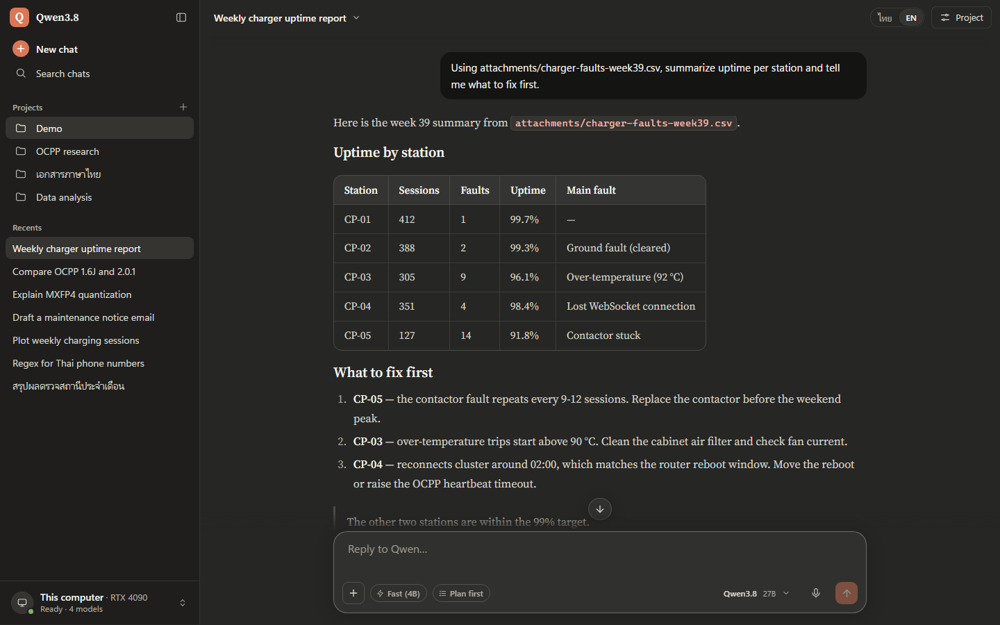

> **Status.** This is a personal setup that grew feature by feature on one Windows 11 laptop. It works
> day to day and has a large test suite, but it is not a packaged product: paths assume `C:\LLM`, several
> helper environments are expected at fixed places, and most code comments are written in Thai.
> See [Known limitations](#roadmap-and-known-limitations).

## Contents

- [Highlights](#highlights)
- [Screenshots](#screenshots)
- [Features](#features)
- [Architecture](#architecture)
- [Measured performance](#measured-performance)
- [Requirements](#requirements)
- [Quick start](#quick-start)
- [Configuration](#configuration)
- [Project structure](#project-structure)
- [Security notes](#security-notes)
- [Running the tests](#running-the-tests)
- [Roadmap and known limitations](#roadmap-and-known-limitations)
- [Acknowledgements](#acknowledgements)
- [License](#license)

## Highlights

- **Local by default.** llama.cpp router on `127.0.0.1:8099` and every other service bound to loopback. A shared
  bearer token protects the router, embedding server, MCP servers and STT; Origin/Host checks protect the hub, MCP
  and STT; the remote prompt gateway has its own API key.
- **Projects.** Each project gets its own port, chat history, instructions, files, memory, default model and
  thinking mode, and its own isolated tool scope.
- **Bilingual UI.** Thai and English, switchable with one click or `Alt+Shift+L`; the llama.cpp WebUI's own menus
  are translated too (about 700 strings), while chat content is never touched.
- **Tools you can trust.** Files, shell, Python, Office, media and browser tools go through a policy guard. Running
  code or commands, overwriting or editing files and creating scripts need a two-step confirmation that shows you
  exactly what will run.
- **Documents and knowledge.** Read PDF/DOCX/XLSX/PPTX/CSV, OCR scanned Thai and English pages, create DOCX, XLSX,
  PPTX, PDF, CSV and Markdown files, and search project files by keyword and by meaning.
- **Deep research** in the background with a cited Markdown/DOCX report.
- **Voice.** Dictation with faster-whisper on the GPU (CPU fallback) and read-aloud.
- **Long chats keep working.** Automatic compaction summarizes the middle of a conversation when it nears the
  context limit.
- **Dashboards.** Usage (tokens, speed per model, top projects) and Doctor (service health, GPUs, disks, fixes).
- **GPU auto-placement.** Detects the internal GPU and a Thunderbolt eGPU, plans which model goes where, and lets
  you override it per model from the UI. The 27B model went from about 1-2 to **42.8 tok/s** after attaching an
  RTX 4090.

## Screenshots

All but the last screenshot come from a demo hub with synthetic projects, chats and numbers
(see [`projects/tools/demo`](projects/tools/demo/README.md)). The last one is from an earlier test run on the
author's machine.

| | |
|---|---|
| 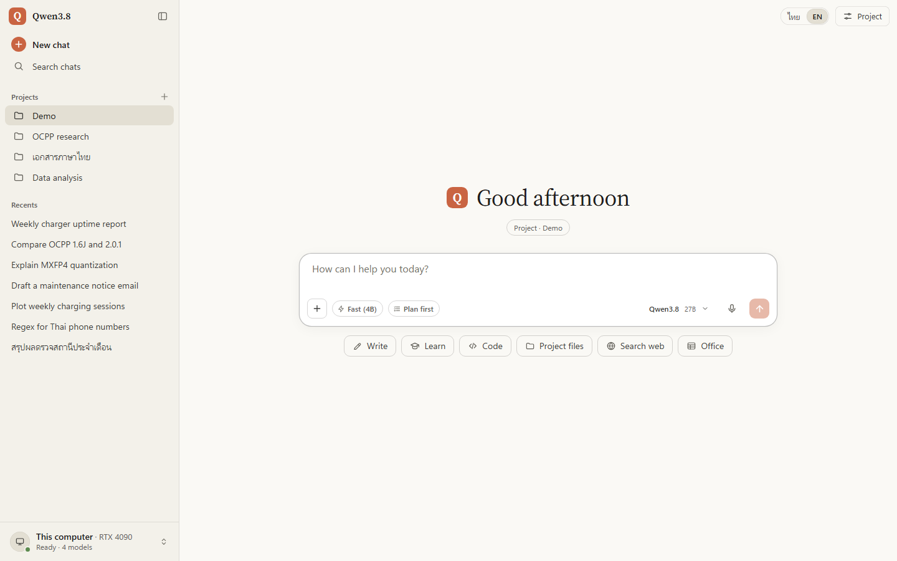 **Start screen** — projects and recent chats in the sidebar, quick-start chips, Fast (4B) and Plan-first toggles. | 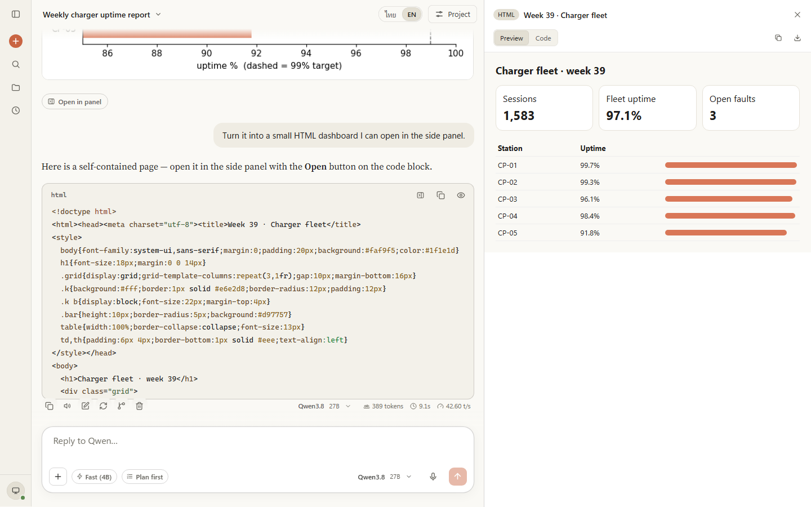 **Artifacts panel** — HTML, SVG, Mermaid, Markdown, CSV and images open beside the chat in a sandboxed frame. |
| 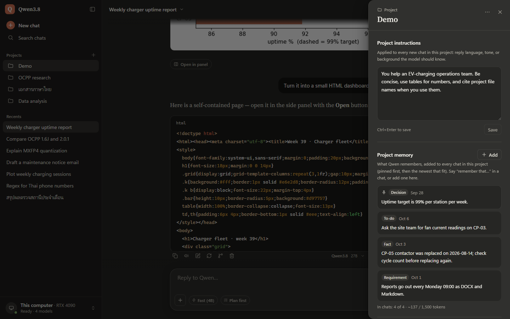 **Project panel** — instructions applied to every chat, and project memory (decisions, requirements, facts, to-dos). | 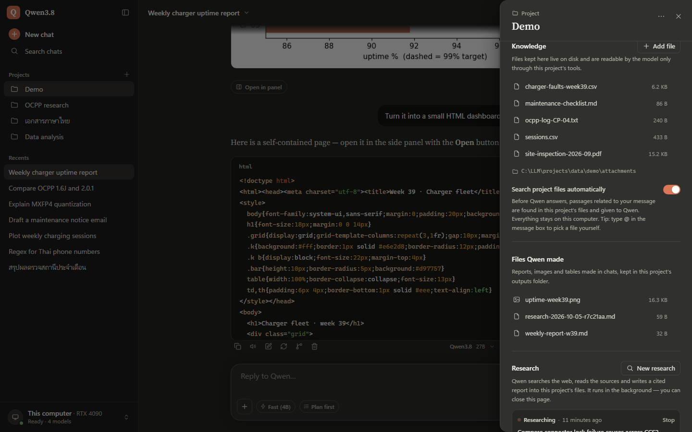 **Knowledge, outputs, research** — project files, automatic file search, files the model made, background research jobs. |
| 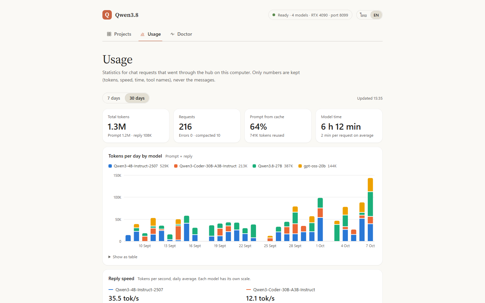 **Usage dashboard** — tokens per day by model, cache reuse, model time; only numbers are logged, never messages. | 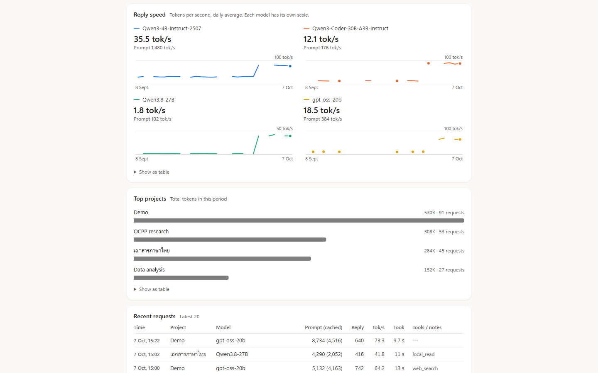 **Reply speed per model** — demo data modeled on the measured speeds before and after attaching the RTX 4090 eGPU. |
| 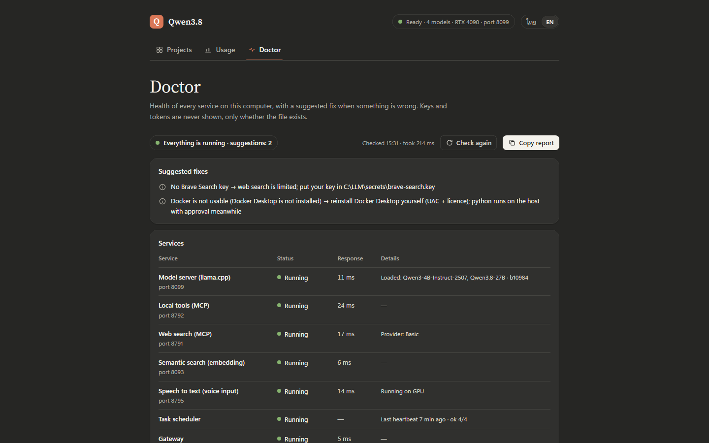 **Doctor** — overall status, a suggested fix for each problem, and every service with its status, response time and details. Further down the page (not in the picture): GPUs, memory, disks, model files and the last test run. Keys are reported as present/absent only. | 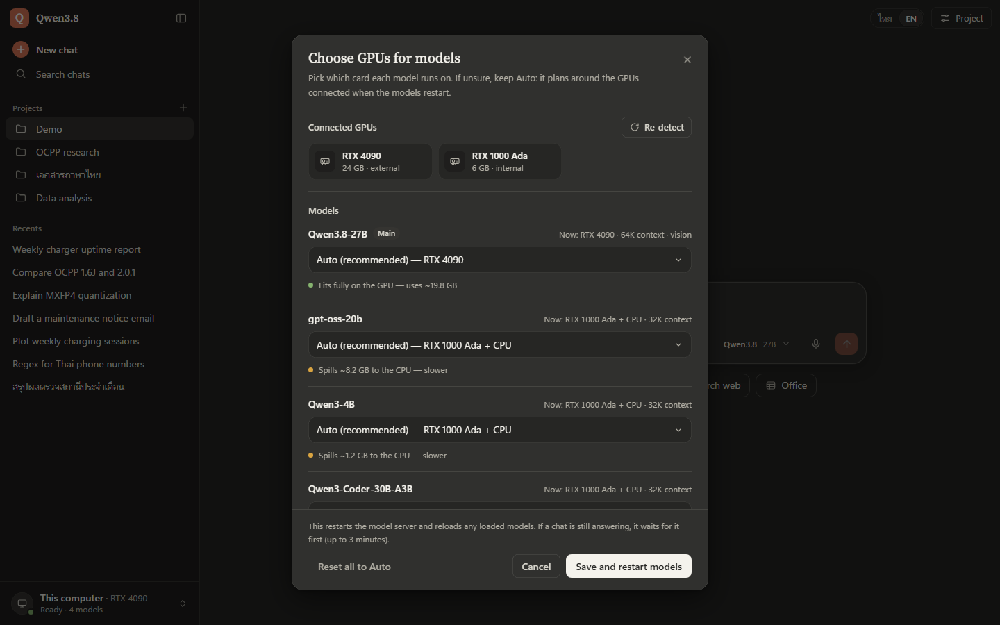 **GPU picker** — per-model placement with fit/spill hints; saving restarts only the model server. |
| 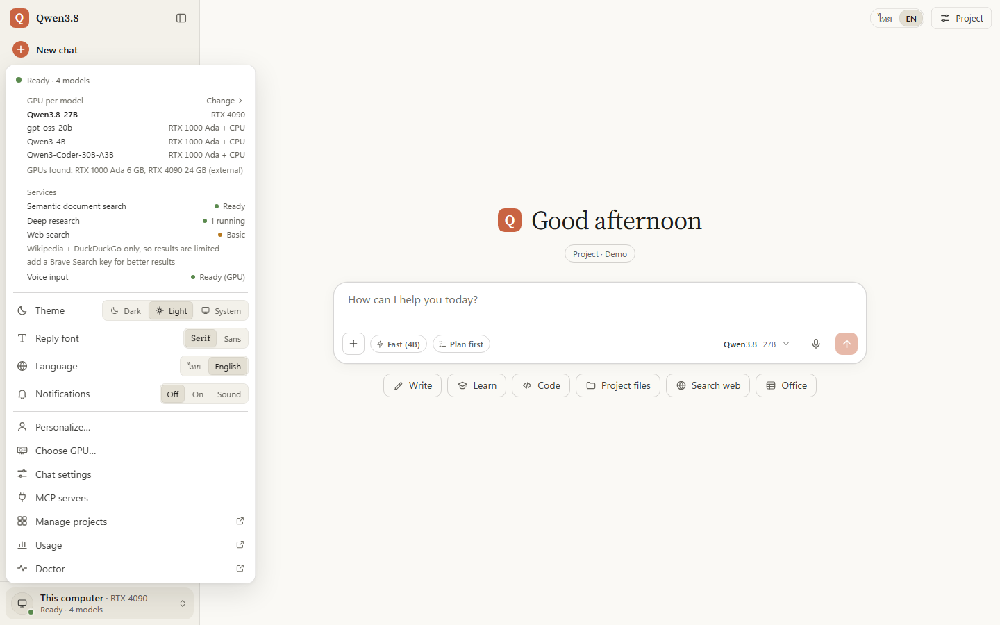 **Account menu** — GPU per model, service status, theme, reply font, language, notifications, personalization. | 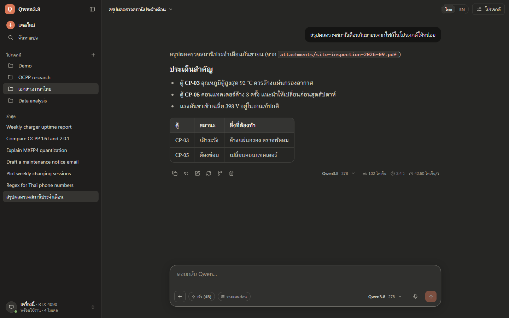 **Thai interface** — the same chat UI in Thai, with Thai-friendly fonts and line height. |
| 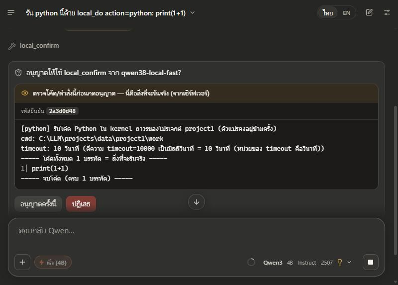 **Two-step confirmation** (Thai UI, from an earlier test run with a `print(1+1)` call) — the Allow card shows the exact code the server will run, fetched from the server, not from the model. The one-time code in the picture expired long ago. | |

## Features

### Chat UI and projects
- Clean, chat-first shell around the llama.cpp WebUI: single sidebar (new chat, search, projects, recents), centered
  greeting, large composer, serif or sans reply font, dark/light/system themes, works down to phone width.
- One port per project (`8101-8179`), each with its own chat history, instructions (system prompt), default model,
  thinking mode (off / on / auto) and auto-continue for long answers.
- Per-project knowledge files (drag and drop, Thai file names), files the model produced, research jobs and memory
  in a side panel.
- Model picker per chat, **Fast (4B)** chip for quick replies, vision input with the 27B model's projector.
- Artifacts panel for HTML (sandboxed, no network), SVG, Mermaid, Markdown, CSV tables and images.
- Export a chat to Markdown, HTML or PDF; quote part of an answer to ask about it; rename, fork and delete chats.
- Desktop notification when a reply finishes in a background tab; the machine is kept awake while a reply streams.
- A base system prompt adds identity, today's date and "answer in the user's language", and the hub applies the
  vendor-recommended sampling settings when the client sets none.

### Tools via guarded MCP
- `mcp-local` (port 8792) serves two surfaces per project: a compact **3-tool surface** (`local_read`, `local_do`,
  `local_confirm`) that small models use reliably, and the **full surface with 50 tools** (files, search, shell,
  checkpoints/undo, media via FFmpeg, background tasks, memory, path aliases, an isolated browser profile, scheduler,
  Python, documents, knowledge search, research, Office, transcription).
- `mcp-websearch` (port 8791): web search and page fetch. Providers: built-in (Wikipedia + DuckDuckGo instant
  answers, no key), Brave, Tavily, Serper or your own SearXNG.
- Every call is checked by `guard.py` and written to an audit log; see [Security notes](#security-notes).

### Documents and knowledge
- **Read** PDF, DOCX, XLSX, CSV, PPTX and text into Markdown with page/sheet markers (zip-bomb and XXE safe).
- **OCR** of scanned PDF pages and images with Tesseract (Thai + English, 300 dpi), with a confidence label per page
  and a cache.
- **Create** DOCX, XLSX, PPTX, PDF, CSV and Markdown files in the project's `outputs` folder, with download links in
  the chat. Every write keeps a checkpoint and shows a diff; undo is one call away.
- **Knowledge search** over attachments and outputs: SQLite FTS5 trigram index plus semantic vectors from a local
  Qwen3-Embedding-0.6B server, fused with reciprocal-rank fusion.
- **Automatic project knowledge:** before the model answers, the hub can look up related passages in the project's
  files and hand them over as clearly labelled, untrusted tool output. `@attachments/<file>` pulls a specific file in.

### Python interpreter and charts
- A persistent Jupyter kernel per project (pandas, matplotlib, plotly from Anaconda), working directory inside the
  project, figures saved as PNG to `outputs` and shown inline. Every run needs approval of the exact code.

### Deep research
- `research` runs in the background: plan, search, pick and read sources, take notes, write a report with
  citations to `outputs` as Markdown and DOCX. Progress, ETA and a Stop button appear in the project panel.

### Skills
- Prompt templates in `skills/<name>/SKILL.md`, served as MCP prompts: type `/` in the composer, pick a skill, fill
  the form. Included: long-document summary, deep research, Python data analysis, code review, formal e-mail, OCPP
  log analysis and EV-charger incident report. File arguments autocomplete from the project's files. The folder is
  write-protected from the model.

### Plan mode
- The **Plan first** chip asks for a numbered plan before doing anything. The hub enforces it server-side by removing
  every tool that could change the machine from that request.

### Office bridge
- Read the workbook, document or presentation you have open in Excel, Word or PowerPoint, and write values into
  Excel or text into Word. Writes need approval, show old and new values, refuse if the target changed since the
  review, and never save or close your file.

### Voice
- **Dictation:** the microphone button records in the browser and the hub forwards the clip to a local
  faster-whisper (large-v3-turbo) service. It uses the GPU when at least 1.5 GB of VRAM is free, otherwise CPU int8,
  and gives the VRAM back two seconds after each clip. Auto language detection is limited to Thai and English.
- **Transcribe files** (audio/video in the project) through the `transcribe` tool; results are cached and indexed.
- **Read aloud** any answer with the browser's speech engine, switching between Thai and English voices.

### Memory and personalization
- Project memory with kinds (decision, requirement, fact, progress, to-do), pinning, and a token budget; the model
  can remember and forget on request, and you can edit entries in the panel.
- "About me" and response style (normal, concise, explanatory, formal, learning, custom) apply to every chat.
- A scheduler tidies each project's `MEMORY.md` nightly and runs a health heartbeat every 30 minutes.

### Automatic compaction
- When a chat passes 80 % of the model's context, the hub keeps the first message and the latest turns and replaces
  the middle with a summary written by the small model: decisions first, then open tasks, facts, files and
  commands. The summary is cached and reused byte-for-byte so the llama.cpp prompt cache still hits. A divider in the
  chat shows how many turns were summarized.
- The summary is treated as untrusted: invented tasks, approval claims, foreign URLs and prompt-injection patterns
  are filtered out, secrets are scrubbed, and if the small model is too slow an extractive digest is used instead.

### Usage and Doctor dashboards
- **Usage** (`http://127.0.0.1:8100/?manage=1#usage`): tokens per day by model, prompt-cache reuse, reply speed per
  model, top projects, recent requests, 7- or 30-day window. The log stores numbers and tool names only.
- **Doctor** (`#doctor`): status and latency of the router, both MCP servers, embedding, STT, scheduler, gateway and
  every project port; GPUs, RAM/commit, disks, model files, recent log errors (redacted) and the last test run, with
  a suggested fix for every problem and a "copy report" button that strips secrets.

### GPU auto-placement and eGPU support
- On every start the launcher runs `gpu_profile.py`, which lists the CUDA devices, reads each GGUF header and writes
  a `models-preset.ini` for the llama.cpp router: if one card can hold the 27B model entirely (RTX 4090), the 27B gets
  that card alone with 64K context and vision, and the other models use the remaining GPU(s) plus CPU; otherwise
  models are split across GPUs and CPU with 32K context.
- When GPUs change (eGPU plugged in or removed), the launcher waits for running chats to finish and restarts only the
  model server. The UI warns when the attached GPUs no longer match the running plan.
- **Choose GPU…** in the account menu: per model Auto / one GPU / several GPUs / CPU only, with "fits fully" or
  "spills to CPU" hints. Priority: automatic plan < UI choice (`gpu-choice.json`) < `models-preset.user.ini`.
- `gpu_bench.py` measures prompt and generation speed per model or per configuration variant.

### Remote prompt gateway
- `mcp-local/gateway.py` (port 8780, loopback only) accepts prompts from local scripts with its own API key, queues
  them (one generation at a time), supports sessions and continuation of cut-off answers, and treats all caller text
  as data.

## Architecture

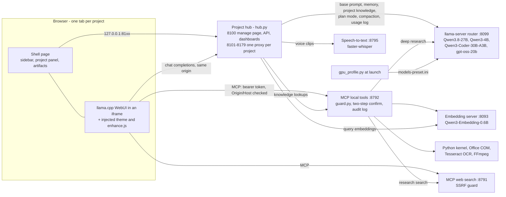

**How the UI works.** The llama.cpp WebUI is a compiled SvelteKit app that cannot be edited, so the hub serves it
inside an iframe on the project's own port and injects a stylesheet (`webui-theme.css`) and a script
(`webui-enhance.js`) into its `<head>`. The outer shell page (templates in `hub_i18n_parts.py`) provides the
sidebar, menus and panels; both share one origin, so they talk through small JavaScript APIs
(`qwenShell`, `qwenShellApi`, `qwenEnhance`). `hub_i18n_parts.py` and the static files hot-reload; the full
design and DOM map are in [docs/DESIGN.md](docs/DESIGN.md).

**What the hub adds to each chat request** (only for requests that come from its own pages): the base system
prompt, "about me" and style, project memory, the project's file list and relevant passages, plan-mode tool
filtering, sampling defaults, then compaction as the last step. Other clients can call a project port with the
OpenAI-compatible API (`http://127.0.0.1:81xx/v1/...`); they are proxied without these page-only additions, and the
hub adds the router token for them.

| Port | Service | Started by |
|---|---|---|
| 8099 | llama-server in router mode: chat models, WebUI files | launcher |
| 8100 | hub: manage page, API, Usage and Doctor dashboards | launcher |
| 8101-8179 | one proxy per project: shell page + WebUI + `/_qwen/*` APIs | hub |
| 8791 | MCP web search | launcher |
| 8792 | MCP local tools (`/mcp/<project>`, `/fast/<project>`) | launcher |
| 8093 | embedding server (llama-server `--embeddings`, CPU) | launcher |
| 8795 | speech-to-text (faster-whisper) | launcher |
| 8780 | remote prompt gateway | launcher |

## Measured performance

Measured with `gpu_bench.py` on the author's laptop (Intel Core Ultra 7 165H, NVIDIA RTX 1000 Ada 6 GB) and with
an ASUS ROG Strix RTX 4090 24 GB attached over Thunderbolt (PCIe Gen4 x4). llama.cpp b10984, CUDA 12.4,
128 generated tokens, thinking off. "Prompt" is prompt-processing speed.

| Model (GGUF) | Laptop RTX 1000 Ada 6 GB + CPU | With the RTX 4090 eGPU |
|---|---|---|
| Qwen3.8-27B UD-Q4_K_M | about 1-2 tok/s, prompt 50-80 tok/s (partly offloaded) | **42.8 tok/s**, prompt 711 tok/s (entirely on the 4090, 64K context + vision) |
| Qwen3-4B-Instruct-2507 Q4_K_M | 27-30 tok/s, prompt 0.7-1.3K tok/s | 79.7 tok/s, prompt 4.4K tok/s (4090 + RTX 1000)\* |
| Qwen3-Coder-30B-A3B-Instruct UD-Q4_K_XL | — | 91.0 tok/s, prompt 476 tok/s (4090 + RTX 1000 + CPU)\* |
| gpt-oss-20b MXFP4 | — | 68.5 tok/s, prompt 1,337 tok/s (4090 + RTX 1000 + CPU)\* |

\* Measured with **Choose GPU** set to the RTX 4090 + RTX 1000 for these models. Under the automatic plan the 27B
keeps the RTX 4090 to itself and the other models run on the internal GPU + CPU, so expect speeds closer to the
laptop column for them.

Other measurements from the same machine:

- CPU threads matter on a hybrid CPU: in an earlier A/B test with the 27B offloaded (laptop power-throttled, older
  settings, hence the lower absolute numbers), 6 threads (P-cores only) gave 0.84 tok/s and 14 threads 0.57 tok/s.
  The launcher defaults to 6.
- Dictation: a 13 s clip transcribed in 2.7 s on the GPU; on CPU (int8) about 21-24 s for a 10-12 s clip.
- Image input for the 27B on the laptop: capping the vision projector at 768 image tokens cut a 4000 px photo from
  348 s to 74 s (projector on the CPU at the time), and the model still read the values correctly.
- Deep research job (standard depth, built-in search provider): about 3 minutes end to end with the 4B model.

## Requirements

| | Required | Notes |
|---|---|---|
| OS | Windows 11 | Developed on 10.0.26200; launcher and stop scripts are Windows PowerShell 5.1 |
| GPU | NVIDIA, recent driver | Developed with driver 596.71. 6 GB runs the 4B model well; the 27B needs about 20 GB of VRAM for interactive speed |
| llama.cpp | b10984 Windows CUDA 12.4 build in `C:\LLM\llama.cpp-b10984` | The UI layer is mapped to this build's WebUI; newer builds may need selector updates (see DESIGN.md §4) |
| Python | 3.13 installed to `C:\Python313` + `requirements.txt` | Choose "Customize installation" and set that location: the launcher, `restart_svc.ps1` and the tests call `C:\Python313\python.exe`. Hub is standard library only; document tools need PyMuPDF, python-docx, openpyxl, defusedxml, NumPy, Pillow |
| Models | GGUF files in `C:\LLM\models` | **`Qwen3.8-27B-UD-Q4_K_M.gguf` is required** (the launcher exits without it); the others are optional. Not included; see [THIRD_PARTY.md](THIRD_PARTY.md). Embedding model expected at `D:\LLM\models-embed\Qwen3-Embedding-0.6B-Q8_0.gguf` |
| Anaconda | optional | Python tool kernel and Office bridge: `%USERPROFILE%\anaconda3\python.exe` by default (jupyter_client, ipykernel, pandas, matplotlib, plotly, pywin32, psutil); point `QWEN_PY_KERNEL_PYTHON` / `QWEN_OFFICE_PYTHON` at another interpreter if yours lives elsewhere |
| faster-whisper | optional | Voice input: conda env named `flexxfast` under `%USERPROFILE%\anaconda3\envs` with faster-whisper 1.2, CTranslate2, PyAV; model large-v3-turbo in the Hugging Face cache (or set `QWEN_STT_HF_HUB`) |
| Tesseract | optional | OCR: Tesseract 5.4 in `C:\LLM\tools\tesseract` with `tessdata_best` tha + eng |
| Microsoft Office | optional | Office bridge (Excel, Word, PowerPoint via COM) |
| FFmpeg | optional | Media tools; on `PATH`, in `C:\LLM\tools\ffmpeg\bin`, or set `MCP_LOCAL_FFMPEG` / `MCP_LOCAL_FFPROBE` |
| Microsoft Edge | included with Windows | Headless screenshot harness and the isolated browser tool |
| Node.js | optional | Some UI tests run JavaScript functions in Node |

## Quick start

1. Install the prerequisites above, including Python 3.13 at `C:\Python313` and Git.
2. Clone the code into a **new, empty** `C:\LLM` (the scripts use absolute paths). `git clone` refuses a folder that
   already has files in it; if you have an older install there, rename it first instead of turning it into a
   working tree, because an install folder also holds logs, secrets and user data that must never be committed.

   ```powershell
   git clone https://github.com/SukritJaAIproject/Qwen-Local-AI-Workbench.git C:\LLM
   C:\Python313\python.exe -m pip install -r C:\LLM\requirements.txt
   ```

3. Add the parts that are not in the repository (both folders are git-ignored): unpack the llama.cpp build into
   `C:\LLM\llama.cpp-b10984` and put your GGUF files in `C:\LLM\models`. File names are the model ids, e.g.
   `Qwen3.8-27B-UD-Q4_K_M.gguf` (required), `mmproj-Qwen3.8-27B-F16.gguf` (vision, optional),
   `Qwen3-4B-Instruct-2507-Q4_K_M.gguf` (Fast chip and summaries, optional).
4. Create your local config from the examples. `ui-config.json` is required; the launcher exits without it.

   ```powershell
   Copy-Item C:\LLM\ui-config.example.json C:\LLM\ui-config.json
   Copy-Item C:\LLM\projects\settings.example.json C:\LLM\projects\settings.json   # optional: English UI (default is Thai)
   Copy-Item C:\LLM\models-preset.user.example.ini C:\LLM\models-preset.user.ini   # optional: GPU overrides
   Copy-Item C:\LLM\mcp-local\config.example.json C:\LLM\mcp-local\config.json     # optional: narrow tool write access
   ```

5. Start everything: double-click `C:\LLM\Qwen38.cmd`, or

   ```powershell
   powershell -NoProfile -ExecutionPolicy Bypass -File C:\LLM\start-qwen38.ps1
   ```

   On first start the launcher creates `C:\LLM\secrets\local-services.token`, plans the GPUs, starts the MCP
   servers, embedding, STT, the model router, the hub, the scheduler and the gateway, then opens
   `http://127.0.0.1:8100`. A fresh install has no projects yet: create one on that page, then open it to chat on
   its own port. The UI starts in Thai unless you copied `settings.example.json`; switch with the ไทย | EN toggle
   or `Alt+Shift+L`. Use `-Unattended` for scripted starts (no prompts, no browser; exit code 0 = ready).
6. Stop everything with `powershell -NoProfile -ExecutionPolicy Bypass -File C:\LLM\stop-qwen38.ps1`. It stops the
   processes listening on the stack's ports, then **every** remaining `llama-server.exe` and any Python process
   running `scheduler.py`, so stop other llama.cpp servers you run yourself first.

Optional: put a Brave Search API key in `C:\LLM\secrets\brave-search.key` for real web search, and restrict the
folder's permissions as described in [secrets/README.md](secrets/README.md).

## Configuration

| What | Where |
|---|---|
| Projects (name, port, instructions, model, thinking, auto-continue, auto knowledge) | the UI, stored in `projects/projects.json` |
| Language, theme, reply font, "about me", style | the UI, stored in `projects/settings.json` (example: `projects/settings.example.json`) |
| GPU per model | **Choose GPU…** in the account menu → `gpu-choice.json`; permanent overrides in `models-preset.user.ini` |
| Context size, threads, vision, main model for one run | launcher flags `-Ctx N`, `-Threads N`, `-Vision` / `-NoVision`, `-Primary <id>` |
| Optional services | launcher flags `-NoEmbed`, `-NoStt`, `-RestartStt`, `-RestartEmbed`, `-EmbedOnly`, `-SttOnly`, `-NoBrowser` |
| Tool permissions (writable folders, extra blocked paths) | `mcp-local/config.json` (start from `mcp-local/config.example.json`); merged with the built-in policy, see [Security notes](#security-notes) |
| Web search provider | `mcp-websearch/config.json` (start from `config.example.json`) or just `secrets/brave-search.key` |
| Skills | `skills/<name>/SKILL.md`; optional per-project enable/disable list in `skills/enabled.json` |
| Gateway API key | `GATEWAY_API_KEY` user environment variable |
| Restart one service with a clean environment | `projects\tools\restart_svc.ps1 -Name mcp-local` (or `websearch`, `scheduler`, `hub`) |

Useful environment overrides: `LLM_LOCAL_TOKEN_FILE` (token file for tests), `QWEN_PY_KERNEL_PYTHON` and
`QWEN_OFFICE_PYTHON` (interpreter for the Python tool and Office bridge), `MCP_LOCAL_FFMPEG` / `MCP_LOCAL_FFPROBE`,
`QWEN_BRAVE_KEY_FILE`, `QWEN_STT_MODEL`, `QWEN_STT_DEVICE`, `QWEN_STT_LANGUAGES`, `QWEN_STT_HF_HUB` (Hugging Face
cache folder for the speech model), `QWEN_SKILLS_DIR`. Services are started with your normal user environment, so
set these as user environment variables.

## Project structure

The repository mirrors the install folder `C:\LLM`.

```text
C:\LLM
├── start-qwen38.ps1          launcher: token, MCP, embedding, STT, GPU plan, router, hub, scheduler, gateway
├── stop-qwen38.ps1           stops the services on their ports, then any leftover llama-server.exe and scheduler.py
├── Qwen38.cmd                double-click wrapper for the launcher
├── gpu_profile.py            GPU detection + per-model placement -> models-preset.ini, gpu-profile.json
├── gpu_bench.py              speed benchmark per model or configuration variant
├── secrets_util.py           shared token, Origin/Host checks, secret scrubbing
├── requirements.txt          packages for C:\Python313
├── *.example.*               config templates (copy without ".example")
├── projects\
│   ├── hub.py                project hub: API + manage page (8100), per-project proxies (8101-8179)
│   ├── hub_i18n_parts.py     shell and manage-page templates, Thai/English strings (hot-reloaded)
│   ├── hub_compact.py        automatic conversation compaction
│   ├── hub_usage.py          usage log and aggregation
│   ├── hub_doctor.py         health report for the Doctor page
│   ├── record_tests.py       runs the test suite, records the result for the Doctor page
│   ├── static\               theme, enhance script, design tokens, boot script, fonts (OFL)
│   └── tools\                shot.py (headless screenshots), restart_svc.ps1, fixtures\, demo\
├── mcp-local\                MCP "this computer": server, guard, netguard, tools_*.py, scheduler, gateway,
│                             Office helper, Jupyter kernel runner, document extractor, skills loader,
│                             config.example.json (tool permission overrides)
├── mcp-websearch\            MCP web search and fetch
├── stt\                      speech-to-text service and benchmark
├── skills\                   prompt templates served as MCP prompts
├── tests\                    unittest suite (+ simulated GPU fixtures)
├── docs\
│   ├── DESIGN.md             engineering notes: UI architecture, contracts, DOM map, every build round
│   └── screenshots\
└── secrets\                  README only; the real files are git-ignored
```

Runtime folders that are created locally and git-ignored: `models\`, `logs\`, `projects\data\` (chats are in the
browser's IndexedDB; attachments, outputs, memory, research, usage log and caches are here), `browser-profile\`,
`tools\` (Tesseract, FFmpeg).

## Security notes

The model can run tools on your computer, so the stack is built around keeping it on a short leash:

- **Loopback only, tokens on the back-end services.** Every service listens on `127.0.0.1`. The router, embedding
  server, both MCP servers and STT require `Authorization: Bearer <token>` (from `secrets/local-services.token`,
  compared in constant time). The hub adds the token server-side when it proxies; the page receives it only for its
  MCP connections. The remote prompt gateway uses its own key (`GATEWAY_API_KEY`). llama-server itself does not
  check the Host header; it relies on the token.
- **Origin and Host checks** on the hub, MCP and STT block other web pages and DNS rebinding. CORS answers only the
  stack's own ports, without credentials. llama.cpp's `--ui-mcp-proxy` is deliberately not used.
- **Policy guard (`mcp-local/guard.py`).** Secret folders and credential files (SSH keys, browser profiles and
  history, git and package-manager credentials, CLI tokens, this stack's own secrets) cannot be read.
  **Default writable roots:** your user folder (`%USERPROFILE%`), `C:\LLM`, and the **whole `D:\`, `E:\` and `F:\`
  drives** if they exist; the rest of `C:\` is read-only and other drives are not reachable. To narrow this, create
  `mcp-local/config.json` (see `mcp-local/config.example.json`): it is merged with the built-in policy, so you can
  add roots, block more paths or make a built-in root read-only, but not remove a built-in block. The stack's own
  code, configuration (including that file), skills and Windows start-up locations are write-protected even with
  approval. Destructive commands (`format`, `diskpart`, `reg`, `net user`, `shutdown`, …) are refused permanently.
  Every call is audited.
- **Two-step confirmation with server-side review.** Actions that change the machine — running commands or Python,
  editing or overwriting files, creating scripts and programs, writing into Office documents, starting or stopping
  background tasks, opening the isolated browser — return a one-time token instead of running. The token is valid
  for 10 minutes (at most 15 if a mismatched review has to be sent again). Only the separate `local_confirm` tool can
  redeem it, and the chat shows an Allow card that loads the exact review text from the server: full code with line
  numbers, the full command, or the diff. Hidden and look-alike characters are made visible, a review sent by the
  model that differs from the server's is flagged in red, and "always allow" is removed for this tool.
- **SSRF guard (`netguard.py`).** Web fetches and the browser tool resolve and check every redirect hop, pin the IP
  at connect time, and refuse loopback, private, link-local and cloud-metadata addresses.
- **Project isolation.** Each project's tools are bound to its own URL (`/mcp/<project>`); tools cannot read or
  write another project's data. Plan mode removes write tools on the server, not just in the prompt.
- **Untrusted content stays data.** Text from files, web pages and tools is labelled as data; automatic knowledge
  is delivered as a tool result instead of being pasted into the user's message; compaction summaries are filtered
  and defanged; secret values are scrubbed from tool output, logs, the Doctor report and summaries.
- **Clean service environments.** The launcher starts long-running services through WMI so they do not inherit
  the environment (and any tokens) of the shell that launched them.

Residual risks you should know about: a command you approve can do anything your account can do; **new files of
non-executable types (documents, text, data, HTML and so on) can be created in any writable root without
confirmation** — overwrites, edits and new scripts or executables need approval; the secrets folder inherits broad
permissions until you restrict it (see [secrets/README.md](secrets/README.md)); the MCP token is stored in the
browser's local storage for the project origins; the Python tool runs on the host, not in a container.

## Running the tests

```powershell
C:\Python313\python.exe -m unittest discover -s C:\LLM\tests
C:\Python313\python.exe C:\LLM\projects\record_tests.py        # same, and records the result for the Doctor page
```

The last full run on the author's machine: 1,550 tests, 1,501 passed, 49 skipped, 0 failures. Tests that need
live services, a browser, Office or a GPU skip themselves when those are not available. Several live suites are
opt-in through environment flags: `LLM_SECURITY_LIVE`, `LLM_B3_LIVE`, `LLM_STT_LIVE`, `LLM_STACK_LIVE`,
`GPU_PROFILE_ROUTER_TESTS`, and the browser end-to-end suites `QWEN_B3_E2E` and `QWEN_UI_E2E` (set to `1`).
The suite was written for the author's layout (`C:\LLM`, `C:\Python313`, the Anaconda and `flexxfast`
interpreters, a `D:` drive); on a machine set up differently some tests skip and a few may fail.

## Roadmap and known limitations

- **Fixed paths.** The code assumes `C:\LLM`, `C:\Python313`, `%USERPROFILE%\anaconda3` (or the
  `QWEN_PY_KERNEL_PYTHON` / `QWEN_OFFICE_PYTHON` overrides), a conda env named `flexxfast` and
  `D:\LLM\models-embed`. A configurable install root is the first thing to fix for other machines.
- **Windows only.** Launcher, Office bridge, WMI process handling and keep-awake are Windows-specific.
- **Tied to one llama.cpp WebUI build.** The UI layer injects into the WebUI of b10984; newer builds may move
  elements. The DOM map in [docs/DESIGN.md](docs/DESIGN.md) is the place to update.
- **No container sandbox yet.** Python and shell commands run on the host behind the two-step approval. A Docker
  sandbox is planned.
- **Web search** without an API key only covers Wikipedia and DuckDuckGo instant answers.
- **Small models need explicit cues.** The 4B model calls the knowledge search reliably when the question mentions
  files or documents; a bare question about project data may get "no data".
- **Compaction on a shared GPU.** If the small summarizer model has to share VRAM with a busy 27B, the first reply
  after compaction can be slow; the UI does not yet show summarizing progress.
- **Language of the code.** Most comments, log messages and parts of the engineering notes are in Thai.
- **Planned:** configurable paths, container sandbox, compaction progress and a summary viewer in the UI, and
  evaluation of speculative decoding drafts and newer models on the RTX 4090.

## Acknowledgements

- [llama.cpp](https://github.com/ggml-org/llama.cpp) and its WebUI, which do the heavy lifting.
- The Qwen team for the Qwen3 model family and Qwen3-Embedding, and OpenAI for gpt-oss.
- [Unsloth](https://unsloth.ai) and [ggml-org](https://huggingface.co/ggml-org) for GGUF quantizations.
- [Tesseract OCR](https://github.com/tesseract-ocr/tesseract), [faster-whisper](https://github.com/SYSTRAN/faster-whisper),
  [PyMuPDF](https://github.com/pymupdf/PyMuPDF), python-docx, openpyxl and the Jupyter project.
- Source Serif 4 (Adobe) and Noto Serif Thai (The Noto Project Authors), under the SIL Open Font License.
- The [Model Context Protocol](https://modelcontextprotocol.io) specification.

Full third-party notes: [THIRD_PARTY.md](THIRD_PARTY.md).

This is an independent personal project. It is not affiliated with or endorsed by Alibaba Cloud or the Qwen team,
OpenAI, the ggml / llama.cpp project or Microsoft. Model and product names are trademarks of their
respective owners and are used here only to describe what the software works with.

## License

MIT — see [LICENSE](LICENSE). Copyright (c) 2026 Sukrit Jaidee.
Models, llama.cpp, Tesseract and the other components listed in [THIRD_PARTY.md](THIRD_PARTY.md) keep their own
licenses.
