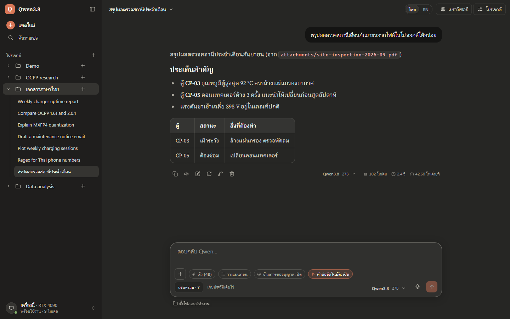
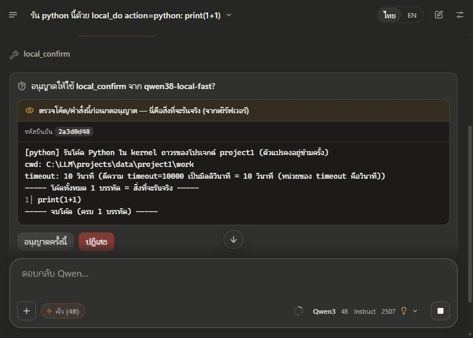
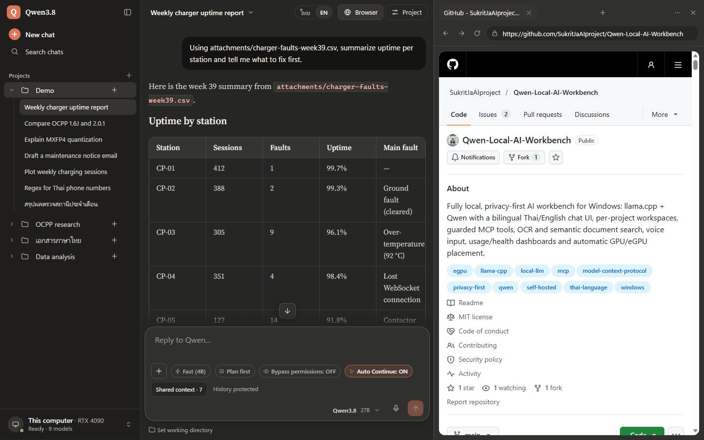
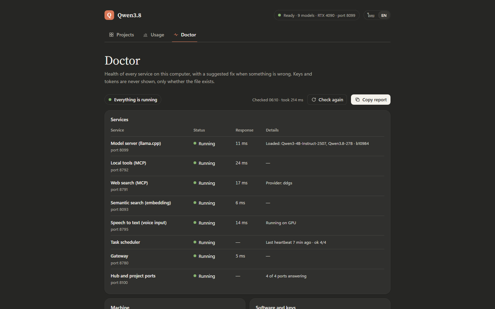
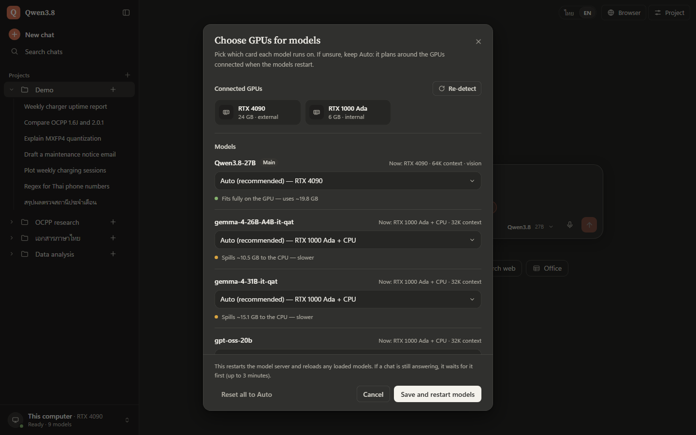

<div align="center">

# Qwen Local AI Workbench

**ชุดทำงาน AI ส่วนตัวที่ทำงานบนเครื่อง Windows ของคุณเองทั้งหมด**<br>
แชต โปรเจกต์ เครื่องมือที่ต้องอนุมัติก่อนทำงาน เอกสาร เสียง และการจัดวางโมเดลลง GPU อัตโนมัติ สร้างบน llama.cpp และ Qwen<br>
หน้าจอรองรับภาษาไทย อังกฤษ ญี่ปุ่น และจีนตัวย่อ

[](https://github.com/SukritJaAIproject/Qwen-Local-AI-Workbench/actions/workflows/tests.yml)
[](https://github.com/SukritJaAIproject/Qwen-Local-AI-Workbench/releases/latest)
[](LICENSE)
[](#สิ่งที่ต้องมี)
[](#สิ่งที่ต้องมี)

[English](README.md) · **ภาษาไทย** · [日本語](README.ja.md) · [简体中文](README.zh-CN.md)

</div>



> [!NOTE]
> เอกสารนี้เป็นฉบับสรุปของ [README ภาษาอังกฤษ](README.md) รายละเอียดเรื่องสถาปัตยกรรม การตั้งค่า ความปลอดภัย
> และการทดสอบอยู่ในฉบับภาษาอังกฤษ

## ภาพรวม

Qwen Local AI Workbench ครอบเซิร์ฟเวอร์ llama.cpp และ WebUI ในตัวของมันด้วยหน้าแชตที่เรียบง่าย มีพื้นที่ทำงานแยกตามโปรเจกต์
เครื่องมือผ่าน MCP ที่มีด่านตรวจ เบราว์เซอร์ในตัว การอ่าน/สร้างเอกสารและค้นข้อมูลในไฟล์ พิมพ์ด้วยเสียง แดชบอร์ดการใช้งาน
และสุขภาพระบบ รวมถึงการจัดวางโมเดลลง GPU ในเครื่องกับ eGPU ที่ต่อผ่าน Thunderbolt ให้อัตโนมัติ

โมเดล แชต ไฟล์ embedding OCR และการถอดเสียง ทำงานบน `127.0.0.1` ทั้งหมด ข้อมูลออกจากเครื่องเฉพาะตอนใช้เครื่องมือเว็บ
(ค้นเว็บ ดึงหน้าเว็บ เบราว์เซอร์แยก แผงเบราว์เซอร์ในตัว หรืองานวิจัยเชิงลึก) เครื่องมือค้นเว็บเปิดไว้ทุกโปรเจกต์ตั้งแต่แรก
และทุกครั้งที่เรียกใช้เครื่องมือจะแสดงให้เห็นในแชต

| | |
|---|---|
| **ใช้กับ** | Windows 11 + GPU NVIDIA: 6 GB รันโมเดล 4B ได้ลื่น ส่วน 27B ควรมี VRAM ราว 20 GB (ได้ 42.8 tok/s บน eGPU RTX 4090) |
| **โมเดล** | ตั้งค่าไว้สำหรับ Qwen3.8-27B (อ่านรูปได้), Qwen3-4B, Qwen3-Coder-30B-A3B และ gpt-oss-20b ไฟล์ GGUF อื่นที่วางใน `C:\LLM\models` จะขึ้นในตัวเลือกโมเดลด้วย |
| **ภาษา** | หน้าจอ ข้อความจากเครื่องมือ รายงาน Doctor รายงานวิจัย การพิมพ์ด้วยเสียง และ OCR รองรับ ไทย · English · 日本語 · 中文 |
| **ความเป็นส่วนตัว** | ทุกบริการฟังเฉพาะ `127.0.0.1` มี token และตรวจ Origin/Host ส่วนคำสั่ง โค้ด และการแก้ไฟล์ต้องรอคุณอนุมัติ |
| **ติดตั้ง** | clone ลง `C:\LLM` ใส่ llama.cpp กับไฟล์โมเดล แล้วดับเบิลคลิก `Qwen38.cmd` ([เริ่มต้นใช้งาน](#เริ่มต้นใช้งาน)) |

> [!IMPORTANT]
> ระบบนี้เป็นชุดที่ค่อยๆ เพิ่มความสามารถบนโน้ตบุ๊ก Windows 11 เครื่องเดียว ใช้งานจริงทุกวันและมีชุดทดสอบขนาดใหญ่
> แต่ยังไม่ใช่ผลิตภัณฑ์สำเร็จรูป: path ต่างๆ ผูกกับ `C:\LLM` และสภาพแวดล้อมเสริมหลายตัวต้องอยู่ในตำแหน่งที่กำหนดไว้

## ความสามารถหลัก

- **ทำงานในเครื่อง:** ทุกบริการทำงานบน `127.0.0.1` ตัวจัดการโมเดล (router) embedding, MCP และบริการถอดเสียงป้องกันด้วย token
- **สี่ภาษาครบทั้งระบบ:** หน้าจอ เมนูของ llama.cpp WebUI รายงาน Doctor คำอธิบายและผลลัพธ์ของเครื่องมือ หน้ายืนยัน
  รายงานวิจัยเชิงลึก การพิมพ์ด้วยเสียง และ OCR รองรับไทย อังกฤษ ญี่ปุ่น และจีนตัวย่อ โดยไม่แตะเนื้อหาในแชต
- **โปรเจกต์:** แต่ละโปรเจกต์มีพอร์ต ประวัติแชต คำสั่งประจำโปรเจกต์ (system prompt) ไฟล์ ความจำ โมเดลเริ่มต้น และโหมดคิด
  ของตัวเอง และขอบเขตเครื่องมือแยกจากกัน
- **เครื่องมือที่ไว้ใจได้:** เครื่องมือไฟล์ shell, Python, Office, สื่อ และเบราว์เซอร์แยก ผ่านด่านตรวจนโยบายทุกครั้ง
  และงานที่เปลี่ยนแปลงเครื่องต้องยืนยันสองขั้นที่แสดงสิ่งที่จะรันจริงให้ดูก่อน
- **เอกสารและคลังความรู้:** อ่าน PDF / DOCX / XLSX / PPTX / CSV, OCR หน้าสแกนภาษาไทยและอังกฤษ, สร้างไฟล์ DOCX / XLSX /
  PPTX / PDF / CSV / Markdown และค้นไฟล์ในโปรเจกต์ได้ทั้งด้วยคำค้นและความหมาย
- **วิจัยเชิงลึก:** ทำงานเบื้องหลัง แล้วเขียนรายงานพร้อมอ้างอิงเป็น Markdown และ DOCX
- **เบราว์เซอร์ในตัว:** แผงเบราว์เซอร์ข้างแชตแยกตามโปรเจกต์ คุณกับโมเดลใช้แท็บเดียวกันที่มองเห็นได้
  และเข้าถึงได้เฉพาะที่อยู่สาธารณะ
- **งาน agent ยาวๆ:** ส่งข้อความถัดไปเข้าคิวได้ระหว่างที่โมเดลทำงาน Auto Continue ทำต่อให้เมื่อถึงขีดจำกัดจำนวนรอบ
  และต่อคำตอบที่หลุดกลางทางโดยไม่รันเครื่องมือที่เสร็จแล้วซ้ำ
- **เสียง:** พิมพ์ด้วยเสียงด้วย faster-whisper บน GPU (ใช้ CPU เมื่อ VRAM ไม่พอ) และอ่านคำตอบออกเสียง
- **แชตยาวไม่สะดุด:** เมื่อแชตใกล้เต็มบริบทของโมเดล ระบบสรุปช่วงกลางของบทสนทนาให้อัตโนมัติ
- **แดชบอร์ด:** การใช้งาน (token ความเร็วแต่ละโมเดล โปรเจกต์ที่ใช้มาก) และ Doctor (สถานะบริการ GPU ดิสก์ พร้อมวิธีแก้)
- **จัดวาง GPU อัตโนมัติ:** ตรวจ GPU ในเครื่องกับ eGPU แล้ววางแผนว่าโมเดลไหนอยู่ที่ใด ปรับเองจากหน้าจอได้
  หลังต่อ RTX 4090 โมเดล 27B เร็วขึ้นจากราว 1-2 เป็น **42.8 tok/s**

## เหมาะกับคุณไหม

**เหมาะ ถ้าคุณ**
- มีคอมพิวเตอร์ Windows 11 ที่มี GPU NVIDIA และอยากใช้ AI โดยให้แชต ไฟล์ และโมเดลอยู่ในเครื่องตัวเอง
- ทำงานกับเอกสาร ไฟล์สแกน และไฟล์เสียงภาษาไทย อังกฤษ ญี่ปุ่น หรือจีน และอยากค้น อ่าน และสรุปในเครื่อง
- อยากให้โมเดลลงมือทำงานบนเครื่อง (ไฟล์ คำสั่ง Python, Office) แต่ต้องได้เห็นก่อนว่าจะรันอะไรจริง
- ใช้ PowerShell แก้ไฟล์ตั้งค่า JSON และอ่านหน้าตรวจสุขภาพระบบได้

**ยังไม่เหมาะ ถ้าคุณ**
- ใช้ macOS หรือ Linux หรือ GPU ของ AMD หรือ Intel: ตัวเปิดระบบ การวางแผน GPU และ llama.cpp ที่ใช้ ทำมาสำหรับ
  Windows กับ NVIDIA CUDA
- ต้องการตัวติดตั้งแบบคลิกเดียว หรือติดตั้งที่อื่นที่ไม่ใช่ `C:\LLM` ([#2](https://github.com/SukritJaAIproject/Qwen-Local-AI-Workbench/issues/2))
- อยากให้หลายคนใช้ร่วมกันหรือเข้าจากอุปกรณ์อื่น: ทุกบริการฟังเฉพาะ `127.0.0.1`
- มี VRAM น้อยกว่า 20 GB มาก แต่อยากใช้โมเดล 27B ที่ความเร็วพอคุยโต้ตอบ: บน GPU โน้ตบุ๊ก 6 GB ได้ราว 1-2 token
  ต่อวินาที (โมเดล 4B เร็วพอบนเครื่องแบบนั้น แต่ตัวเปิดระบบยังต้องมีไฟล์ 27B)

## ใช้งานเป็นภาษาไทย

- **ภาษาเริ่มต้น:** หน้าจอเริ่มเป็นภาษาไทย สลับภาษาได้ด้วยปุ่ม ไทย | EN | 日本語 | 中文 หรือกด `Alt+Shift+L`
  ค่าเก็บไว้ที่ `"lang"` ใน `projects\settings.json`
- **เครื่องมือ:** รายการเครื่องมือ คำอธิบาย ผลลัพธ์ ข้อผิดพลาด และหน้ายืนยันก่อนรัน เป็นภาษาไทยตามหน้าจอ
- **คำตอบและรายงาน:** โมเดลถูกสั่งให้ตอบตามภาษาที่คุณพิมพ์ รายงานวิจัยเชิงลึกเขียนตามภาษาของคำถาม
- **พิมพ์ด้วยเสียง:** ตรวจภาษาไทยและอังกฤษอัตโนมัติ คลิปสั้นที่ฟังไม่ชัดจะถือเป็นภาษาไทย
- **OCR:** อ่านไทย + อังกฤษ ด้วย `tha.traineddata` และ `eng.traineddata` จาก
  [tessdata_best](https://github.com/tesseract-ocr/tessdata_best)
- **อ่านออกเสียง:** ใช้เสียงที่ติดตั้งในเครื่องตามอักษรของแต่ละย่อหน้า (เช่น Microsoft Pattara สำหรับภาษาไทย)
  ข้อความจึงไม่ถูกส่งไปบริการเสียงออนไลน์

## ภาพหน้าจอ

| | |
|---|---|
|  **ยืนยันสองขั้น** (หน้าจอไทย) — การ์ดอนุญาตแสดงโค้ดที่เซิร์ฟเวอร์จะรันจริง ดึงจากเซิร์ฟเวอร์ ไม่ใช่จากโมเดล |  **แผงเบราว์เซอร์ในตัว** — โปรไฟล์ Edge แยกต่อโปรเจกต์ คุณกับโมเดลใช้แท็บเดียวกัน และเข้าถึงได้เฉพาะที่อยู่สาธารณะ |
|  **Doctor** — สถานะรวม วิธีแก้ของแต่ละปัญหา และสถานะกับเวลาตอบสนองของทุกบริการ |  **เลือก GPU** — กำหนด GPU ต่อโมเดล พร้อมบอกว่าใส่ได้ทั้งหมดหรือจะล้นไป CPU บันทึกแล้วรีสตาร์ตเฉพาะเซิร์ฟเวอร์โมเดล |

ภาพหน้าจออื่นอยู่ในส่วน [Screenshots](README.md#screenshots) ของฉบับภาษาอังกฤษ (ภาพเป็นหน้าจออังกฤษ สลับเป็นไทยแล้วจะเห็นหน้าเดียวกันเป็นภาษาไทย)

## สิ่งที่ต้องมี

| | จำเป็น / ไม่บังคับ | หมายเหตุ |
|---|---|---|
| ระบบปฏิบัติการ | Windows 11 | สคริปต์เปิดและปิดระบบใช้ Windows PowerShell 5.1 |
| GPU | NVIDIA (ไดรเวอร์รุ่นใหม่) | 6 GB รันโมเดล 4B ได้ลื่น ส่วน 27B ต้องมี VRAM ราว 20 GB ถึงจะเร็วพอใช้งานโต้ตอบ |
| llama.cpp | รุ่น b10984 สำหรับ Windows CUDA 12.4 ไว้ที่ `C:\LLM\llama.cpp-b10984` | หน้าจอปรับให้เข้ากับ WebUI ของรุ่นนี้ |
| Python | 3.13 ติดตั้งที่ `C:\Python313` + `requirements.txt` | ตอนติดตั้งเลือก "Customize installation" แล้วกำหนดตำแหน่งนี้ |
| Git | Git for Windows | ใช้ clone และอัปเดตโค้ด |
| โมเดล | ไฟล์ GGUF ใน `C:\LLM\models` | **ต้องมี `Qwen3.8-27B-UD-Q4_K_M.gguf`** (ไม่มีแล้วตัวเปิดระบบจะหยุด) ไม่ได้แนบโมเดลมาใน repo (ดู [THIRD_PARTY.md](THIRD_PARTY.md)) |
| Tesseract | ไม่บังคับ | OCR: Tesseract 5.4 ใน `C:\LLM\tools\tesseract` กับ tessdata_best ภาษา tha + eng |
| faster-whisper | ไม่บังคับ | พิมพ์ด้วยเสียง (conda env ชื่อ `flexxfast` ใน Anaconda) รายละเอียดดู [Requirements](README.md#requirements) |
| Office / FFmpeg / Docker Desktop | ไม่บังคับ | เชื่อม Office / เครื่องมือสื่อ / sandbox สำหรับ Python |

## เริ่มต้นใช้งาน

1. ติดตั้งสิ่งที่ต้องมีด้านบน รวมถึง Python 3.13 ที่ `C:\Python313` และ Git
2. clone โค้ดลงโฟลเดอร์ `C:\LLM` **ที่สร้างใหม่และว่างเปล่า** (สคริปต์ใช้ path เต็ม) ถ้ามีของเดิมอยู่ ให้เปลี่ยนชื่อโฟลเดอร์เดิมก่อน

   ```powershell
   git clone https://github.com/SukritJaAIproject/Qwen-Local-AI-Workbench.git C:\LLM
   C:\Python313\python.exe -m pip install -r C:\LLM\requirements.txt
   ```

3. ใส่ส่วนที่ไม่มีใน repo: จาก [llama.cpp รุ่น b10984](https://github.com/ggml-org/llama.cpp/releases/tag/b10984) ให้แตกไฟล์ `llama-b10984-bin-win-cuda-12.4-x64.zip` และ
   `cudart-llama-bin-win-cuda-12.4-x64.zip` (ไลบรารี CUDA) ลงโฟลเดอร์เดียวกันคือ `C:\LLM\llama.cpp-b10984` จากนั้น
   ดาวน์โหลดโมเดลลง `C:\LLM\models` ชื่อไฟล์คือ id ของโมเดล จึงต้องใช้ชื่อเดิม ยกเว้นไฟล์ projector สำหรับอ่านรูป
   ที่ต้องเปลี่ยนชื่อ

   | ไฟล์ | ดาวน์โหลดจาก | ขนาด | ใช้ทำอะไร |
   |---|---|---|---|
   | `Qwen3.8-27B-UD-Q4_K_M.gguf` | [unsloth/Qwen3.8-27B-GGUF](https://huggingface.co/unsloth/Qwen3.8-27B-GGUF) | 16.5 GB | **จำเป็น**: โมเดลหลัก |
   | `mmproj-F16.gguf` เปลี่ยนชื่อเป็น `mmproj-Qwen3.8-27B-F16.gguf` | repo เดียวกัน | 0.9 GB | ไม่บังคับ: ให้ 27B อ่านรูป |
   | `Qwen3-4B-Instruct-2507-Q4_K_M.gguf` | [unsloth/Qwen3-4B-Instruct-2507-GGUF](https://huggingface.co/unsloth/Qwen3-4B-Instruct-2507-GGUF) | 2.5 GB | ไม่บังคับ: ปุ่ม Fast, สรุปแชต, งานวิจัย |
   | `Qwen3-Coder-30B-A3B-Instruct-UD-Q4_K_XL.gguf` | [unsloth/Qwen3-Coder-30B-A3B-Instruct-GGUF](https://huggingface.co/unsloth/Qwen3-Coder-30B-A3B-Instruct-GGUF) | 17.7 GB | ไม่บังคับ |
   | `gpt-oss-20b-MXFP4.gguf` | [ggml-org/gpt-oss-20b-GGUF](https://huggingface.co/ggml-org/gpt-oss-20b-GGUF) | 12.1 GB | ไม่บังคับ |

   การค้นหาตามความหมายใช้ `Qwen3-Embedding-0.6B-Q8_0.gguf` (0.6 GB จาก [Qwen/Qwen3-Embedding-0.6B-GGUF](https://huggingface.co/Qwen/Qwen3-Embedding-0.6B-GGUF)) วางไว้ที่
   `D:\LLM\models-embed` แต่ละโมเดลมีสัญญาอนุญาตของตัวเอง ตรวจที่หน้าโมเดลก่อนใช้
4. สร้างไฟล์ตั้งค่าจากตัวอย่าง ต้องมี `ui-config.json` เสมอ

   ```powershell
   Copy-Item C:\LLM\ui-config.example.json C:\LLM\ui-config.json
   ```

5. ดับเบิลคลิก `C:\LLM\Qwen38.cmd` เพื่อเปิดระบบ หรือสั่งจาก PowerShell

   ```powershell
   powershell -NoProfile -ExecutionPolicy Bypass -File C:\LLM\start-qwen38.ps1
   ```

   ครั้งแรกระบบจะสร้าง token วางแผน GPU เปิดบริการทั้งหมด แล้วเปิด `http://127.0.0.1:8100` ติดตั้งใหม่จะยังไม่มีโปรเจกต์
   ให้สร้างโปรเจกต์ในหน้านั้นก่อน แล้วเปิดเข้าไปเพื่อเริ่มแชต
6. เปิด **Doctor** (`http://127.0.0.1:8100/?manage=1#doctor`) ตรวจว่าทุกบริการเป็นสีเขียว ถ้ามีปัญหาจะมีวิธีแก้บอกไว้
7. ปิดระบบด้วย `powershell -NoProfile -ExecutionPolicy Bypass -File C:\LLM\stop-qwen38.ps1` คำสั่งนี้หยุด
   `llama-server.exe` **ทุกตัว** ที่ยังค้างอยู่ด้วย ถ้าคุณรัน llama.cpp server อื่นเองอยู่ ให้หยุดตัวนั้นก่อน

เมื่อจะอัปเดต ให้ปิดระบบ สั่ง `git pull` ใน `C:\LLM` สั่ง `pip install` จากข้อ 2 อีกครั้ง แล้วเปิดระบบ
ค้นเว็บได้โดยไม่ต้องมี API key (DDGS) ถ้าจะใช้ Brave Search หรือผู้ให้บริการอื่น ดู [Quick start](README.md#quick-start)
ในฉบับภาษาอังกฤษ

## ความปลอดภัยโดยย่อ

- งานที่เปลี่ยนแปลงเครื่อง (รันคำสั่งหรือ Python, แก้หรือเขียนทับไฟล์, สร้างสคริปต์, เขียนลงเอกสาร Office ฯลฯ)
  จะไม่รันจนกว่าคุณจะดูรายละเอียดที่เซิร์ฟเวอร์สร้าง (โค้ดเต็ม คำสั่ง หรือ diff) แล้วกดอนุญาต
- เครื่องมือในตัวของโหมด agent ของ llama.cpp (เปิดอยู่ตั้งแต่แรก: จัดการไฟล์และรันคำสั่ง) ไม่ผ่านด่านตรวจและการยืนยันสองขั้นนี้
  มีเพียงหน้าขออนุญาตของ WebUI เป็นด่านเดียว ถ้าไม่ใช้ ให้เปิดระบบด้วย `-Agent:$false`
- เปิด **Bypass permissions** (ปิดอยู่ตั้งแต่แรก ตั้งแยกต่อโปรเจกต์) แล้วการอนุญาตทั้งหมดจะผ่านอัตโนมัติ
- ไฟล์ใหม่ที่ไม่ใช่ไฟล์ทำงานได้ (เอกสาร ข้อความ ข้อมูล ฯลฯ) อาจถูกสร้างในโฟลเดอร์ที่เขียนได้โดยไม่ต้องยืนยัน
- รายละเอียดทั้งหมดอยู่ที่ [Security notes](README.md#security-notes) ในฉบับภาษาอังกฤษ

## ข้อจำกัดที่ทราบ

- **path ตายตัว:** ระบบคาดว่าจะมี `C:\LLM`, `C:\Python313`, `%USERPROFILE%\anaconda3`, conda env ชื่อ `flexxfast`
  และ `D:\LLM\models-embed` ([#2](https://github.com/SukritJaAIproject/Qwen-Local-AI-Workbench/issues/2))
- **ใช้ได้เฉพาะ Windows:** ตัวเปิดระบบ การเชื่อม Office และการจัดการโปรเซสพึ่ง Windows
- **ผูกกับ WebUI ของ llama.cpp รุ่น b10984:** รุ่นใหม่กว่าอาจต้องปรับส่วนหน้าจอ
- **sandbox ยังไม่ครอบคลุมทั้งหมด:** Python รันใน Docker sandbox ได้ (ไม่บังคับ) แต่คำสั่ง shell, การเชื่อม Office
  และเครื่องมือในตัวของ llama.cpp ยังรันบนเครื่องจริง

## ร่วมพัฒนาและสัญญาอนุญาต

ยินดีรับ issue และ pull request ทั้งภาษาไทยและอังกฤษ คำถามหรือไอเดียโพสต์ได้ที่
[Discussions](https://github.com/SukritJaAIproject/Qwen-Local-AI-Workbench/discussions) วิธีตั้งค่าสำหรับพัฒนาอยู่ใน
[CONTRIBUTING.md](CONTRIBUTING.md) ส่วนปัญหาด้านความปลอดภัยให้แจ้งแบบไม่เปิดเผยตามวิธีใน [SECURITY.md](SECURITY.md)

ใช้สัญญาอนุญาต MIT ([LICENSE](LICENSE)) ส่วนโมเดล llama.cpp, Tesseract และส่วนประกอบอื่นใน [THIRD_PARTY.md](THIRD_PARTY.md)
เป็นไปตามสัญญาอนุญาตของแต่ละตัว โปรเจกต์นี้เป็นโปรเจกต์ส่วนตัวที่ไม่ได้เกี่ยวข้องหรือได้รับการรับรองจาก Alibaba Cloud / ทีม Qwen,
OpenAI, โปรเจกต์ ggml / llama.cpp หรือ Microsoft
