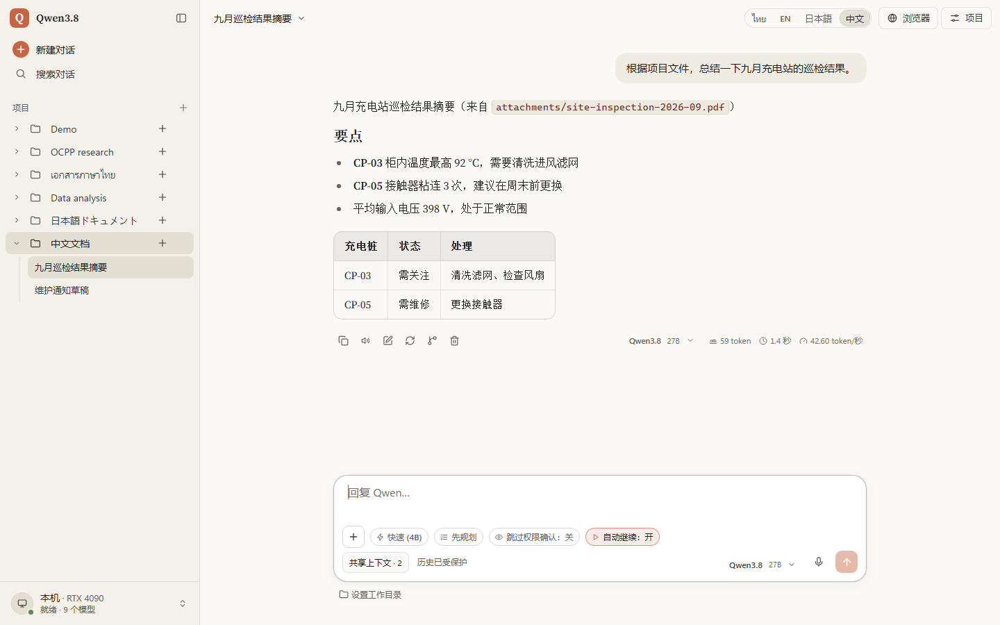
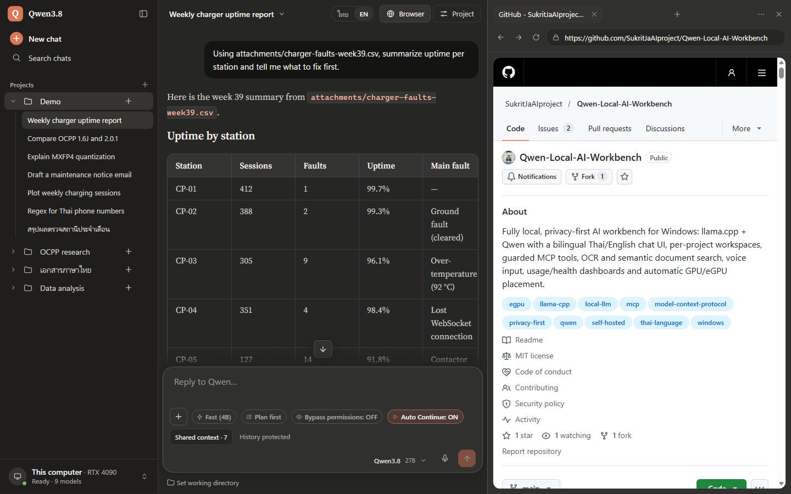
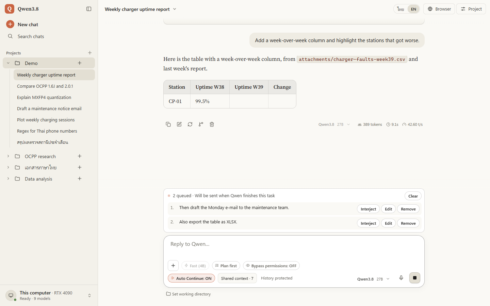
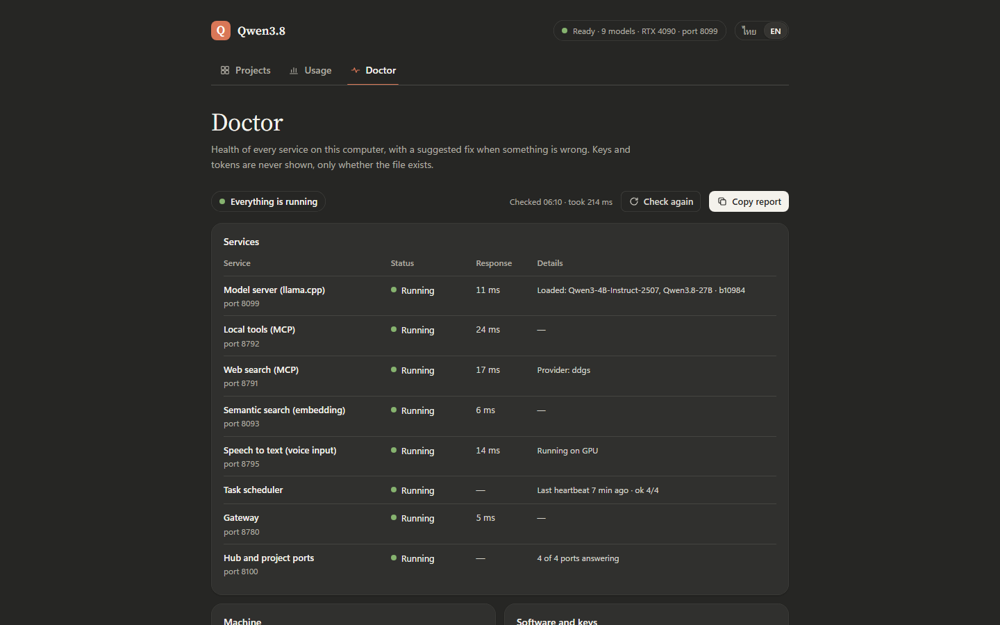
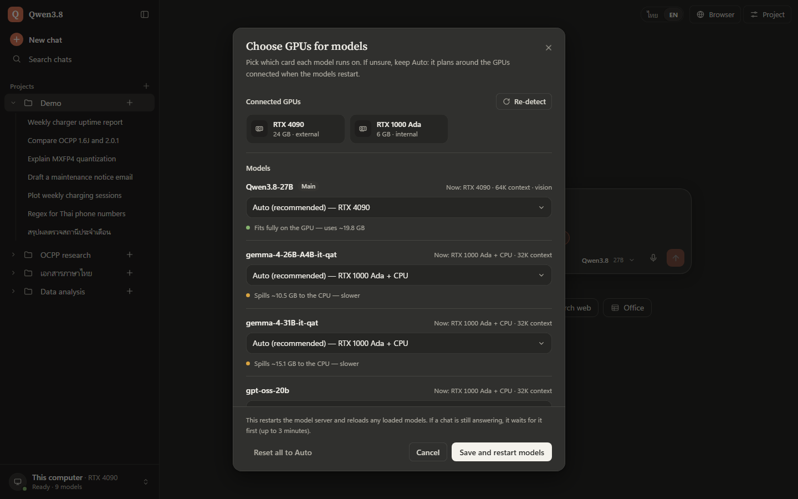

<div align="center">

# Qwen Local AI Workbench

**完全在你自己的 Windows 电脑上运行的私有 AI 工作台**<br>
聊天、项目、需确认的工具、文档、语音和 GPU 自动分配，基于 llama.cpp 和 Qwen，<br>
界面支持简体中文、英文、日文和泰文。

[](https://github.com/SukritJaAIproject/Qwen-Local-AI-Workbench/actions/workflows/tests.yml)
[](https://github.com/SukritJaAIproject/Qwen-Local-AI-Workbench/releases/latest)
[](LICENSE)
[](#运行要求)
[](#运行要求)

[English](README.md) · [ภาษาไทย](README.th.md) · [日本語](README.ja.md) · **简体中文**

</div>



> [!NOTE]
> 本文是英文版 [README](README.md) 的摘要。架构、配置、安全和测试的详细说明请看英文版。
> 从 v1.2.0 起支持日文和简体中文（[发布说明](https://github.com/SukritJaAIproject/Qwen-Local-AI-Workbench/releases/tag/v1.2.0)）。

## 简介

Qwen Local AI Workbench 用一个简洁、以聊天为中心的界面包装了 llama.cpp 服务器及其内置 WebUI，提供按项目划分的工作区、
需确认的本机工具（MCP）、内置浏览器、文档读取与生成、文件检索、语音输入、用量与健康状态面板，以及在内置 GPU 和
雷电（Thunderbolt）外接 eGPU 之间自动分配模型。

模型、聊天、文件、向量嵌入、OCR 和语音识别全部运行在 `127.0.0.1` 上。只有在使用联网工具（网页搜索、网页抓取、
隔离浏览器、内置浏览器面板、深度研究）时数据才会离开本机。每个项目默认启用网页搜索工具，每次工具调用都会显示在聊天中。

| | |
|---|---|
| **运行环境** | Windows 11 + NVIDIA GPU：4B 模型 6 GB 显存即可流畅运行，27B 需要约 20 GB 显存（外接 RTX 4090 时 42.8 tok/s） |
| **模型** | 已为 Qwen3.8-27B（支持图像输入）、Qwen3-4B、Qwen3-Coder-30B-A3B 和 gpt-oss-20b 配置好；放进 `C:\LLM\models` 的其他 GGUF 文件也会出现在模型选择中 |
| **语言** | 界面、工具消息、Doctor、研究报告、语音输入和 OCR 支持 ไทย · English · 日本語 · 中文 |
| **隐私** | 所有服务只监听 `127.0.0.1`，有令牌和 Origin/Host 检查；命令、代码和文件修改都要等你确认 |
| **安装** | clone 到 `C:\LLM`，放好 llama.cpp 和模型文件，双击 `Qwen38.cmd`（[快速开始](#快速开始)） |

> [!IMPORTANT]
> 这是在一台 Windows 11 笔记本上逐步搭建起来的个人环境。每天都在使用，也有大量测试，但还不是打包好的产品：
> 路径默认是 `C:\LLM`，几个辅助环境也需要放在固定位置。代码注释大多是泰文。

## 主要功能

- **完全本地：** 所有服务都运行在 `127.0.0.1`，路由器、向量嵌入、MCP 和语音识别都由令牌保护。
- **四种语言全覆盖：** 界面、llama.cpp WebUI 的菜单、Doctor、工具说明与结果、确认页面、深度研究报告、语音输入和 OCR
  都支持简体中文、英文、日文和泰文。聊天内容本身不会被翻译。
- **项目：** 每个项目有自己的端口、聊天记录、指令（系统提示词）、文件、记忆、默认模型和思考模式，工具的作用范围也相互隔离。
- **可放心使用的工具：** 文件、命令行、Python、Office、媒体和隔离浏览器等工具都经过策略守卫，任何会改动电脑的操作都需要
  两步确认，并原样展示将要执行的内容。
- **文档与知识库：** 读取 PDF / DOCX / XLSX / PPTX / CSV，对扫描件做 OCR，生成 DOCX / XLSX / PPTX / PDF / CSV / Markdown，
  并按关键词和语义检索项目文件。
- **深度研究：** 在后台检索资料，输出带引用的 Markdown 和 DOCX 报告。
- **内置浏览器：** 聊天旁边有每个项目专用的浏览器面板，你和模型操作同一个可见标签页，并且只能访问公网地址。
- **长时间的智能体任务：** 模型工作时可以排队发送下一条消息；Auto Continue 会在达到轮次上限时自动继续，连接中断的回复会
  重新接上，已完成的工具不会重复执行。
- **语音：** 在 GPU 上用 faster-whisper 做语音输入（显存不足时改用 CPU），并可朗读回答。
- **长对话不中断：** 接近上下文上限时，自动把对话中间部分压缩成摘要。
- **面板：** 用量（令牌数、各模型速度、各项目）和 Doctor（服务状态、GPU、磁盘以及修复建议）。
- **GPU 自动分配：** 检测内置 GPU 和雷电 eGPU，规划每个模型放在哪里，也可以在界面中手动调整。接上 RTX 4090 后，
  27B 模型从约 1–2 tok/s 提升到 **42.8 tok/s**。

## 适合你吗？

**适合你，如果你**
- 有一台装 NVIDIA GPU 的 Windows 11 电脑，希望聊天、文件和模型都留在这台电脑上；
- 需要在本地检索、读取和总结中文、英文、日文或泰文的文档、扫描件和录音；
- 想让模型操作你的电脑（文件、命令、Python、Office），但一定要先看到将要执行的具体内容；
- 不排斥 PowerShell、JSON 配置文件和健康状态页面。

**暂时不适合，如果你**
- 使用 macOS 或 Linux，或者 AMD、Intel 显卡：启动脚本、GPU 规划和 llama.cpp 版本都是为 Windows 和 NVIDIA CUDA 准备的；
- 需要一键安装程序，或要装到 `C:\LLM` 以外的位置（[#2](https://github.com/SukritJaAIproject/Qwen-Local-AI-Workbench/issues/2)）；
- 要给多人使用或从其他设备访问：所有服务只监听 `127.0.0.1`；
- 显存远低于 20 GB 却想让 27B 模型以对话速度运行：在 6 GB 的笔记本 GPU 上每秒只有 1–2 个 token（4B 模型在那里很快，
  但启动脚本仍需要 27B 的文件）。

## 使用中文

- **切换：** 点 ไทย | EN | 日本語 | 中文 按钮，或按 `Alt+Shift+L`。设置保存在 `projects\settings.json` 的 `"lang"`
  （中文是 `"zh"`）。
- **工具：** 工具列表与说明、结果、错误信息和执行前的确认页面都会变成中文，切换后 2 秒内生效，无需重启。
- **回答与报告：** 模型会用你提问的语言回答；深度研究的报告、标题和来源列表也用提问的语言撰写。
- **语音输入：** 除泰文和英文外，还会自动识别中文；简短或听不清的语音按中文处理。
- **OCR：** 把 [tessdata_best](https://github.com/tesseract-ocr/tessdata_best) 的 `chi_sim.traineddata`（竖排文字还需要
  `chi_sim_vert.traineddata`）放到 `C:\LLM\tools\tesseract\tessdata`，扫描件和照片中的中文也能识别。无需重启，
  缺少文件时 Doctor 会提示。
- **朗读：** 每个段落都用与文字相符的本机语音朗读，不会发送到在线语音服务。要听中文，请在 Windows 设置的“时间和语言”中
  添加中文语音。

## 截图

| | |
|---|---|
|  **内置浏览器面板** — 每个项目独立、隔离的 Edge 配置文件；你和模型操作同一个标签页，只能访问公网地址。 |  **消息队列** — 回复生成时按 Enter 可以排队下一条消息，每条都能插队、编辑或删除。 |
|  **Doctor** — 总体状态、每个问题的修复建议，以及每个服务的状态和响应时间。 |  **选择 GPU** — 按模型分配 GPU，并提示能否完整放下或会溢出到 CPU；保存后只重启模型服务器。 |

更多界面见英文版的 [Screenshots](README.md#screenshots)。截图是英文界面，切换到中文后同样的界面会显示为中文。

## 运行要求

| | 必需 / 可选 | 说明 |
|---|---|---|
| 操作系统 | Windows 11 | 启动和停止脚本使用 Windows PowerShell 5.1 |
| GPU | NVIDIA（较新的驱动） | 4B 模型 6 GB 显存即可流畅运行；27B 要达到可交互的速度需要约 20 GB 显存 |
| llama.cpp | b10984 的 Windows CUDA 12.4 版本，放在 `C:\LLM\llama.cpp-b10984` | 界面是按这个版本的 WebUI 适配的 |
| Python | 3.13，安装到 `C:\Python313`，并安装 `requirements.txt` | 安装时选择 “Customize installation” 并指定这个位置 |
| Git | Git for Windows | 用于 clone 和更新 |
| 模型 | GGUF 文件放在 `C:\LLM\models` | **`Qwen3.8-27B-UD-Q4_K_M.gguf` 是必需的**（没有它启动脚本会退出）。仓库不包含模型（见 [THIRD_PARTY.md](THIRD_PARTY.md)） |
| Tesseract | 可选 | OCR：`C:\LLM\tools\tesseract` 中的 Tesseract 5.4 与 tessdata_best 的 tha + eng（中文另加 chi_sim，竖排另加 chi_sim_vert） |
| faster-whisper | 可选 | 语音输入（Anaconda 中名为 `flexxfast` 的 conda 环境），详见英文版 [Requirements](README.md#requirements) |
| Office / FFmpeg / Docker Desktop | 可选 | Office 联动 / 媒体工具 / Python 沙箱 |

## 快速开始

1. 安装上面的运行要求（包括 `C:\Python313` 中的 Python 3.13 和 Git）。
2. 把代码 clone 到一个**新的空文件夹** `C:\LLM`（脚本使用绝对路径）。如果那里已有旧的安装，请先把文件夹改名。

   ```powershell
   git clone https://github.com/SukritJaAIproject/Qwen-Local-AI-Workbench.git C:\LLM
   C:\Python313\python.exe -m pip install -r C:\LLM\requirements.txt
   ```

3. 放入仓库中没有的部分：从 llama.cpp 的 [b10984 版本](https://github.com/ggml-org/llama.cpp/releases/tag/b10984) 下载 `llama-b10984-bin-win-cuda-12.4-x64.zip` 和
   `cudart-llama-bin-win-cuda-12.4-x64.zip`（CUDA 运行库），解压到同一个文件夹 `C:\LLM\llama.cpp-b10984`。
   然后把模型下载到 `C:\LLM\models`。文件名就是模型 ID，请保持原名；只有图像输入用的投影文件需要改名：

   | 文件 | 来源 | 大小 | 用途 |
   |---|---|---|---|
   | `Qwen3.8-27B-UD-Q4_K_M.gguf` | [unsloth/Qwen3.8-27B-GGUF](https://huggingface.co/unsloth/Qwen3.8-27B-GGUF) | 16.5 GB | **必需**：主模型 |
   | `mmproj-F16.gguf`，改名为 `mmproj-Qwen3.8-27B-F16.gguf` | 同一个仓库 | 0.9 GB | 可选：27B 的图像输入 |
   | `Qwen3-4B-Instruct-2507-Q4_K_M.gguf` | [unsloth/Qwen3-4B-Instruct-2507-GGUF](https://huggingface.co/unsloth/Qwen3-4B-Instruct-2507-GGUF) | 2.5 GB | 可选：Fast 按钮、对话摘要、研究 |
   | `Qwen3-Coder-30B-A3B-Instruct-UD-Q4_K_XL.gguf` | [unsloth/Qwen3-Coder-30B-A3B-Instruct-GGUF](https://huggingface.co/unsloth/Qwen3-Coder-30B-A3B-Instruct-GGUF) | 17.7 GB | 可选 |
   | `gpt-oss-20b-MXFP4.gguf` | [ggml-org/gpt-oss-20b-GGUF](https://huggingface.co/ggml-org/gpt-oss-20b-GGUF) | 12.1 GB | 可选 |

   语义检索使用 `Qwen3-Embedding-0.6B-Q8_0.gguf`（0.6 GB，来自 [Qwen/Qwen3-Embedding-0.6B-GGUF](https://huggingface.co/Qwen/Qwen3-Embedding-0.6B-GGUF)），放在 `D:\LLM\models-embed`。
   每个模型都有自己的许可证，请先查看模型卡。
4. 从示例创建配置文件，`ui-config.json` 是必需的。

   ```powershell
   Copy-Item C:\LLM\ui-config.example.json C:\LLM\ui-config.json
   Copy-Item C:\LLM\projects\settings.example.json C:\LLM\projects\settings.json
   ```

   把复制出来的 `projects\settings.json` 中的 `"lang"` 改成 `"zh"`，启动后就是中文界面（默认是泰文）。
5. 双击 `C:\LLM\Qwen38.cmd` 启动，或在 PowerShell 中运行：

   ```powershell
   powershell -NoProfile -ExecutionPolicy Bypass -File C:\LLM\start-qwen38.ps1
   ```

   首次启动会生成令牌、规划 GPU、启动各项服务，然后打开 `http://127.0.0.1:8100`。新安装还没有项目，请先在这个页面创建一个，
   再打开它开始聊天。
6. 打开 **Doctor**（`http://127.0.0.1:8100/?manage=1#doctor`），确认所有服务都是绿色；有问题时会给出修复建议。
7. 停止时运行 `powershell -NoProfile -ExecutionPolicy Bypass -File C:\LLM\stop-qwen38.ps1`。它会停止**所有**剩余的
   `llama-server.exe`，如果你自己另外运行了 llama.cpp 服务器，请先把它停掉。

以后更新时，先停止，在 `C:\LLM` 中运行 `git pull`，再执行一次第 2 步的 `pip install`，然后启动。网页搜索不需要 API 密钥
（DDGS）；如需改用 Brave Search 等，请看英文版的 [Quick start](README.md#quick-start)。

## 安全要点

- 会改动电脑的操作（运行命令或 Python、编辑或覆盖文件、创建脚本、写入 Office 文档等）在你查看服务器生成的确认内容
  （完整代码、命令或差异）并批准之前不会执行。
- llama.cpp 智能体模式（默认开启）提供的内置工具（文件操作和命令）不经过上述守卫和两步确认，WebUI 的权限提示是唯一的关卡。
  不需要时请用 `-Agent:$false` 参数启动。
- 为某个项目打开 **Bypass permissions**（默认关闭）后，所有批准都会自动完成。
- 文档、文本等非可执行类型的新文件，可能会在可写位置中无需确认就被创建。
- 详细内容请看英文版的 [Security notes](README.md#security-notes)。

## 已知限制

- **固定路径：** 默认使用 `C:\LLM`、`C:\Python313`、`%USERPROFILE%\anaconda3`、conda 环境 `flexxfast` 和
  `D:\LLM\models-embed`（[#2](https://github.com/SukritJaAIproject/Qwen-Local-AI-Workbench/issues/2)）。
- **仅支持 Windows：** 启动脚本、Office 联动和进程管理都依赖 Windows。
- **界面按 llama.cpp b10984 的 WebUI 适配：** 更新的版本可能需要调整界面。
- **沙箱只覆盖一部分：** Python 可以在可选的 Docker 沙箱中运行，但命令行、Office 联动和 llama.cpp 的内置工具在主机上运行。
- 代码注释和日志大多是泰文。

## 参与和许可证

欢迎提交 Issue、Pull Request，或在 [Discussions](https://github.com/SukritJaAIproject/Qwen-Local-AI-Workbench/discussions)
提问和交流想法。开发流程见 [CONTRIBUTING.md](CONTRIBUTING.md)；安全问题请按 [SECURITY.md](SECURITY.md) 的方式私下报告。

本项目采用 MIT 许可证（[LICENSE](LICENSE)）。模型、llama.cpp、Tesseract 等组件按 [THIRD_PARTY.md](THIRD_PARTY.md) 所列，
各自遵循其许可证。这是一个独立的个人项目，与 Alibaba Cloud / Qwen 团队、OpenAI、ggml / llama.cpp 项目和 Microsoft
没有关联，也未获得其认可。
